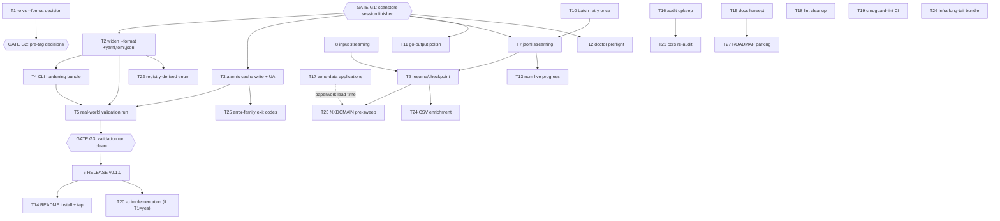

# Pareto Plan — Ship v0.1.0, then Scale Readiness

**Written:** 2026-11-10 00:50 CET · **Repo state:** master @ b27032c
· **Inputs:** `TODO_LIST.md` (13 open items), the 2026-11-09 library audit
(`docs/review/libs/`, 22 reports), status report
`docs/status/2026-11-10_00-36_library-audit-session-review.md` (42 candidates)
· **Freshness check executed:** `--format` enum still 5 values, no `validate:`
tags, go-atomic-write still `// indirect` (go.mod:64), no resume/streaming in
`internal/cli` — every planned task verified still open. CHANGELOG `[Unreleased]`
reviewed; no overlap.

## Gates (read first — verschlimmbessern protection)

- **GATE G1 — concurrent session:** another session is actively building
  `internal/scanstore` + `internal/cli/replay.go` (cli_test.go modified at
  00:50). Every task touching `internal/cli`, `go.mod`, or `flake.nix`
  (vendorHash) waits until their tree is quiet. Do not refactor their code.
- **GATE G2 — release ordering:** the `--format` → `-o` rename decision (T1)
  must happen **before** the v0.1.0 tag (T6). Breaking changes after a tag
  cost a v2; before it, they cost one commit.
- **GATE G3 — tag readiness:** v0.1.0 only after the real-world validation
  run (T5) is clean.

## Pareto breakdown

### The 1% that delivers 51% — THE SPINE: ship v0.1.0

The tool already detects correctly. The single biggest value jump available
is making it _shipped_: format-complete output (one string!), crash-safe
caching (lib already in the binary), scriptable exit codes, one validated
real-world run, a tag. Six tasks, under a day, more than half the
currently-realizable value.

**T1** `-o` decision · **T2** widen `--format` · **T3** atomic cache write +
UA · **T4** CLI hardening bundle · **T5** real-world validation run ·
**T6** release v0.1.0.

### The 4% that delivers 64% — SCALE READINESS

The product exists for bulk technographics; bulk is currently fragile
(all-at-end rendering, full-RAM input, no resume, transient-resolver noise).
**T7** jsonl streaming · **T8** input streaming · **T9** resume ·
**T10** one-shot batch retry.

### The 20% that delivers 80% — POLISH & OPERATIONS

Everything that makes daily use and maintenance pleasant: output polish,
doctor preflight, live progress, install story, docs harvest, audit upkeep,
zone-data paperwork (long lead time — start early), lint cleanup, CI lint.

### The other 20% (to 100%) — LONG TAIL

Pre-filter sweep, CSV enrichment, scoped exit codes, drift-proof enum
generation, cqrs re-audit (post-scanstore), infrastructure niceties
(vendorHash.nix, freshness guard, describe contract test), ROADMAP parking.

## Execution graph

## Level 1 — comprehensive plan (tasks of 30–100 min, ALL TODOs, sorted by importance/impact/effort/customer-value)

| #   | Task                                                                                                                                | Tier | Impact     | Cust.value | Effort | Gate        |
| --- | ----------------------------------------------------------------------------------------------------------------------------------- | ---- | ---------- | ---------- | ------ | ----------- |
| T1  | `-o/--output` vs `--format` decision + STACK.md record                                                                              | 1%   | High       | Medium     | 30m    | —           |
| T2  | Widen `--format` enum to +yaml,toml,jsonl (renderers already registered)                                                            | 1%   | High       | High       | 45m    | G1          |
| T3  | Adopt go-atomic-write `WriteWithPerm` in `writeCache` + UA header on feed                                                           | 1%   | High       | Medium     | 45m    | G1          |
| T4  | CLI hardening: `validate` on --workers, `ExitError(2)` usage errors, `WithEnvPrefix("GDD_")`, RecoveryMiddleware                    | 1%   | High       | High       | 60m    | G1          |
| T5  | Real-world validation run (lead list / Tranco slice), fix fallout                                                                   | 1%   | High       | High       | 90m    | after T2-T4 |
| T6  | **Release v0.1.0** (CHANGELOG cut, tag, both remotes, GitHub release, proxy check)                                                  | 1%   | Very high  | Very high  | 90m    | G2+G3       |
| T7  | jsonl streaming output (render as completed; scan visitor refactor)                                                                 | 4%   | High       | High       | 90m    | G1          |
| T8  | Input streaming in chunks (30M-domain memory fix)                                                                                   | 4%   | High       | High       | 90m    | —           |
| T9  | Resume/checkpointing (`--resume results.jsonl`)                                                                                     | 4%   | High       | High       | 90m    | T7,T8       |
| T10 | One-shot batch retry for transient resolver failures (hand-rolled, NOT go-retry)                                                    | 4%   | Medium     | High       | 45m    | —           |
| T11 | go-output polish: `--color`, SetFooter summary, Title, AddRowChecked                                                                | 20%  | Medium     | Medium     | 60m    | G1          |
| T12 | `WithDoctorCheck` preflight (resolver + ranges feed)                                                                                | 20%  | Medium     | Medium     | 45m    | G1          |
| T13 | nom live progress for long scans (TTY-only)                                                                                         | 20%  | Medium     | Medium     | 60m    | T7          |
| T14 | README install section + Homebrew tap entry                                                                                         | 20%  | Medium     | High       | 45m    | T6          |
| T15 | Docs harvest: TODO_LIST/FEATURES/CHANGELOG/STACK from audit+plan                                                                    | 20%  | Medium     | Medium     | 45m    | —           |
| T16 | Audit upkeep: citation re-verify vs HEAD, screenshot, commit-context, subagent check                                                | 20%  | Medium     | Low        | 45m    | —           |
| T17 | Zone-data applications: DENIC RDS, Nominet DAA, SWITCH                                                                              | 20%  | High(long) | High(long) | 60m    | —           |
| T18 | Lint cleanup pass (err113 ×N, cyclop ×2, wrapcheck, errcheck, tagalign)                                                             | 20%  | Medium     | Low        | 90m    | G1          |
| T19 | cmdguard-lint step in CI (expect 0 findings)                                                                                        | 20%  | Low        | Low        | 30m    | —           |
| T20 | `-o` implementation + JSON error envelopes (only if T1 = adopt)                                                                     | 20%  | Medium     | Medium     | 60m    | T1, post-T6 |
| T21 | Re-audit go-cqrs-lite/cqrs-htmx verdicts after scanstore lands                                                                      | 20%  | Medium     | Low        | 30m    | G1          |
| T22 | Registry-derived `values:` enum (drift-proof, `FormatsForShape`)                                                                    | tail | Medium     | Low        | 45m    | T2          |
| T23 | NXDOMAIN/A-existence pre-sweep pre-filter                                                                                           | tail | High(long) | High(long) | 90m    | T9, T17     |
| T24 | CSV enrichment mode (append verdict columns to input CSV)                                                                           | tail | Medium     | Medium     | 60m    | —           |
| T25 | Scoped go-error-family exit codes in `internal/ranges` (75/65)                                                                      | tail | Low        | Medium     | 30m    | T3          |
| T26 | Infra long-tail: TimeoutMiddleware, describe test, vendorHash.nix, freshness guard, docs-gates cache key, ETag-if-polled, CAA watch | tail | Low        | Low        | 90m    | G1          |
| T27 | ROADMAP parking of deferred items                                                                                                   | tail | Low        | Low        | 30m    | T15         |

**Sequencing note:** T17 (paperwork) should START immediately in parallel —
approval lead times are weeks; nothing else blocks on it.

## Level 2 — fine breakdown (max 12 min per task, ALL TODOs, sorted within each L1 task by importance; global order = L1 order)

| ID   | Task                                                                                  | Imp    | Eff                          | Gate |
| ---- | ------------------------------------------------------------------------------------- | ------ | ---------------------------- | ---- |
| 1.1  | Read cmdguard `WithOutputFormat` + JSON-envelope docs                                 | M      | 5m                           | —    |
| 1.2  | Decision memo: keep `--format` vs adopt `-o` (breaking-cost table)                    | H      | 12m                          | —    |
| 1.3  | Record decision in STACK.md decision log                                              | M      | 5m                           | —    |
| 1.4  | Update audit `cmdguard.md` gap #7 with outcome                                        | M      | 5m                           | —    |
| 1.5  | CHANGELOG Unreleased note if breaking                                                 | M      | 5m                           | —    |
| 2.1  | Edit flag `values:` to `table,json,csv,tsv,markdown,yaml,toml,jsonl`                  | H      | 5m                           | G1   |
| 2.2  | render_test: yaml + toml + jsonl render goldens                                       | H      | 12m                          | G1   |
| 2.3  | describe/doctor golden updates if pinned                                              | M      | 8m                           | G1   |
| 2.4  | cli_test: enum accepts new values, rejects bogus                                      | H      | 8m                           | G1   |
| 2.5  | buildflow green                                                                       | H      | 8m                           | G1   |
| 3.1  | `go get go-atomic-write@v0.6.2` + tidy (direct dep)                                   | H      | 6m                           | G1   |
| 3.2  | Replace `writeCache` body: `WriteWithPerm(path, data, 0o600)`, keep `MkdirAll(0o700)` | H      | 8m                           | G1   |
| 3.3  | `User-Agent: google-domain-detector/<version>` on feed request                        | M      | 6m                           | G1   |
| 3.4  | ranges_test: cache perms + concurrent-run race; confirm NOT `WriteIfChanged`          | H      | 12m                          | G1   |
| 3.5  | buildflow + vendorHash refresh if nix build trips                                     | H      | 12m                          | G1   |
| 4.1  | `validate:"min=1,max=512"` on Workers                                                 | H      | 5m                           | G1   |
| 4.2  | cli_test: `--workers 0` rejected at parse                                             | H      | 8m                           | G1   |
| 4.3  | `NewExitError(2, …)` on both usage errors                                             | H      | 8m                           | G1   |
| 4.4  | cli_test: usage error exits 2, scan failure 1                                         | H      | 8m                           | G1   |
| 4.5  | `WithEnvPrefix("GDD_")` + shorten env tags                                            | M      | 10m                          | G1   |
| 4.6  | cli_test: env resolution via prefix                                                   | M      | 8m                           | G1   |
| 4.7  | RecoveryMiddleware wiring                                                             | M      | 6m                           | G1   |
| 4.8  | cli_test: panic → printed error + exit 1                                              | M      | 8m                           | G1   |
| 5.1  | Prepare lead list or Tranco top-10k slice                                             | H      | 10m                          | —    |
| 5.2  | Run scan (table + json), capture timing/memory                                        | H      | 10m                          | —    |
| 5.3  | Review Error/Skipped rows, classify causes                                            | H      | 12m                          | —    |
| 5.4  | Manually verify 10 verdicts against live DNS                                          | H      | 12m                          | —    |
| 5.5  | Fix fallout round 1                                                                   | H      | 12m                          | —    |
| 5.6  | Fix fallout round 2                                                                   | H      | 12m                          | —    |
| 5.7  | Record results in CHANGELOG + tag-readiness verdict                                   | M      | 8m                           | —    |
| 6.1  | Cut CHANGELOG 0.1.0 section                                                           | H      | 10m                          | G3   |
| 6.2  | Full buildflow green on release commit                                                | H      | 10m                          | G3   |
| 6.3  | Annotated tag v0.1.0                                                                  | H      | 5m                           | G3   |
| 6.4  | Push master+tag to origin AND github mirror                                           | H      | 8m                           | G3   |
| 6.5  | GitHub Release notes                                                                  | H      | 12m                          | G3   |
| 6.6  | Module proxy + pkg.go.dev propagation check                                           | M      | 10m                          | G3   |
| 6.7  | `nix run .#release` wiring check                                                      | M      | 10m                          | G3   |
| 6.8  | `go get` pull-check in scratch dir                                                    | M      | 10m                          | G3   |
| 6.9  | Rollback readiness note (retract plan)                                                | M      | 5m                           | G3   |
| 7.1  | Design: results channel vs visitor callback in scan.Run                               | H      | 10m                          | G1   |
| 7.2  | scan.Run visitor refactor (order-preserving)                                          | H      | 12m                          | G1   |
| 7.3  | Streaming JSONL writer (DTO encode per completed result)                              | H      | 12m                          | G1   |
| 7.4  | Wire `--format jsonl` to streaming path                                               | H      | 5m                           | G1   |
| 7.5  | Semantics doc comment (ordering, cancellation)                                        | M      | 8m                           | G1   |
| 7.6  | Tests: out-of-order completion, cancellation mid-stream                               | H      | 12m                          | G1   |
| 7.7  | 50k-domain smoke run + memory check                                                   | H      | 10m                          | G1   |
| 7.8  | buildflow green                                                                       | H      | 8m                           | G1   |
| 8.1  | Refactor input.Parse to streaming reader                                              | H      | 12m                          | —    |
| 8.2  | Chunked collectDomains                                                                | H      | 12m                          | —    |
| 8.3  | Cross-chunk dedup structure                                                           | H      | 10m                          | —    |
| 8.4  | Streaming-safe CSV header detection                                                   | H      | 12m                          | —    |
| 8.5  | Skipped aggregation across chunks                                                     | M      | 8m                           | —    |
| 8.6  | Memory before/after profile                                                           | M      | 10m                          | —    |
| 8.7  | Parity tests stdin/file/args                                                          | H      | 12m                          | —    |
| 8.8  | buildflow green                                                                       | H      | 8m                           | —    |
| 9.1  | Decide checkpoint format (jsonl out-file doubles as checkpoint)                       | H      | 8m                           | T7   |
| 9.2  | `--resume` flag plumbing + help text                                                  | H      | 10m                          | T7   |
| 9.3  | Build skip-set from existing output file                                              | H      | 10m                          | T7   |
| 9.4  | Append-mode output open                                                               | H      | 8m                           | T7   |
| 9.5  | Integrate with streaming render                                                       | H      | 12m                          | T7   |
| 9.6  | Test: rerun skips completed domains                                                   | H      | 12m                          | T7   |
| 9.7  | Test: corrupt/truncated checkpoint handling                                           | M      | 10m                          | T7   |
| 10.1 | Classify transient vs permanent DNSError                                              | H      | 10m                          | —    |
| 10.2 | Single retry in ScanDomain on transient only                                          | H      | 10m                          | —    |
| 10.3 | Test: hard NXDOMAIN not retried                                                       | H      | 10m                          | —    |
| 10.4 | Test: flaky resolver recovers on retry                                                | H      | 10m                          | —    |
| 10.5 | buildflow green                                                                       | H      | 5m                           | —    |
| 11.1 | `--color auto                                                                         | always | never` flag + ParseColorMode | M    |
| 11.2 | Plumb ColorMode into RenderOptions                                                    | M      | 6m                           | G1   |
| 11.3 | SetFooter summary row ("N domains · M workspace · K gcp")                             | M      | 12m                          | G1   |
| 11.4 | Footer render tests csv/tsv/markdown                                                  | M      | 10m                          | G1   |
| 11.5 | Title option + markdown test                                                          | L      | 8m                           | G1   |
| 11.6 | AddRowChecked swap                                                                    | M      | 6m                           | G1   |
| 11.7 | buildflow green                                                                       | M      | 8m                           | G1   |
| 12.1 | WithDoctorCheck wiring scaffold                                                       | M      | 8m                           | G1   |
| 12.2 | Resolver reachability check (bounded lookup)                                          | M      | 12m                          | G1   |
| 12.3 | Ranges feed fetch+parse check                                                         | M      | 12m                          | G1   |
| 12.4 | doctor_test with fake resolver/feed                                                   | M      | 10m                          | G1   |
| 13.1 | Evaluate go-output/nom API surface                                                    | M      | 8m                           | T7   |
| 13.2 | Wire activity feed into worker loop                                                   | M      | 12m                          | T7   |
| 13.3 | TTY-only activation gate                                                              | M      | 8m                           | T7   |
| 13.4 | CI/pipe quiet-mode verification                                                       | M      | 6m                           | T7   |
| 13.5 | Visual check on 1k-domain run                                                         | M      | 10m                          | T7   |
| 14.1 | README install section (nix/brew/go install) + link check                             | H      | 12m                          | T6   |
| 14.2 | Quickstart + examples block                                                           | M      | 8m                           | T6   |
| 14.3 | Homebrew formula draft in homebrew-tap repo                                           | H      | 12m                          | T6   |
| 14.4 | Tap CI verification                                                                   | M      | 8m                           | T6   |
| 15.1 | Merge audit follow-ups into TODO_LIST (jsonl dedup note)                              | M      | 10m                          | —    |
| 15.2 | FEATURES.md status refresh                                                            | M      | 12m                          | —    |
| 15.3 | CHANGELOG entries for shipped ops work                                                | M      | 8m                           | —    |
| 15.4 | STACK.md rows for newly adopted deps                                                  | M      | 8m                           | —    |
| 15.5 | docs-gates green                                                                      | M      | 7m                           | —    |
| 16.1 | Status-check/stop subagents akiko+celeste; diff late reports                          | L      | 10m                          | —    |
| 16.2 | Re-verify all project citations vs current HEAD                                       | M      | 12m                          | —    |
| 16.3 | Re-screenshot index + href re-check                                                   | L      | 8m                           | —    |
| 16.4 | Add verified-at-commit headers to 22 reports                                          | M      | 10m                          | —    |
| 17.1 | DENIC RDS application draft + send                                                    | H      | 12m                          | —    |
| 17.2 | Nominet DAA application + send                                                        | H      | 12m                          | —    |
| 17.3 | SWITCH zone-data request + send                                                       | H      | 12m                          | —    |
| 17.4 | ccTLD data-usage constraint review                                                    | M      | 12m                          | —    |
| 17.5 | Track application follow-ups in TODO                                                  | M      | 5m                           | —    |
| 18.1 | err113: static sentinels in domain.go                                                 | M      | 12m                          | G1   |
| 18.2 | err113: input.go + ranges.go                                                          | M      | 12m                          | G1   |
| 18.3 | err113: cli.go + replay.go (coordinate with concurrent session)                       | M      | 12m                          | G1   |
| 18.4 | cyclop: extract helper from scan.Run                                                  | M      | 12m                          | G1   |
| 18.5 | cyclop: split ScanDomain stages                                                       | M      | 12m                          | G1   |
| 18.6 | wrapcheck + nilnil + mnd fixes                                                        | M      | 12m                          | G1   |
| 18.7 | errcheck Fprintf + varnamelen + tagalign                                              | L      | 12m                          | G1   |
| 18.8 | Full buildflow green incl. race                                                       | H      | 12m                          | G1   |
| 19.1 | Add cmdguard-lint step to ci.yml                                                      | L      | 10m                          | —    |
| 19.2 | Local run, expect 0 findings                                                          | L      | 8m                           | —    |
| 19.3 | Fix or document any findings                                                          | L      | 12m                          | —    |
| 20.1 | WithOutputFormat adoption + flag swap + describe golden                               | M      | 12m                          | T1   |
| 20.2 | JSON error envelope tests (hint/code fields)                                          | M      | 12m                          | T1   |
| 20.3 | README + audit doc updates                                                            | M      | 8m                           | T1   |
| 21.1 | Read final scanstore/replay shape                                                     | M      | 10m                          | G1   |
| 21.2 | Update go-cqrs-lite.md + cqrs-htmx.md verdicts                                        | M      | 12m                          | G1   |
| 21.3 | Refresh index.html matrix + re-render proof                                           | M      | 8m                           | G1   |
| 22.1 | Investigate registry introspection API (FormatsForShape)                              | M      | 8m                           | T2   |
| 22.2 | Generate flag values from registered formats, drop hardcoded enum                     | M      | 12m                          | T2   |
| 22.3 | Drift-proof test: registry == enum                                                    | M      | 10m                          | T2   |
| 23.1 | Design: parallel A-record existence pass                                              | M      | 12m                          | T9   |
| 23.2 | Implement sweep phase                                                                 | M      | 12m                          | T9   |
| 23.3 | `--pre-filter` flag + help/docs                                                       | M      | 10m                          | T9   |
| 23.4 | Volume-reduction measurement on sample                                                | M      | 10m                          | T9   |
| 23.5 | Worker-pool bounds integration                                                        | M      | 12m                          | T9   |
| 23.6 | Tests                                                                                 | H      | 12m                          | T9   |
| 24.1 | Column-append design incl. header mapping                                             | M      | 10m                          | —    |
| 24.2 | Writer preserving original columns                                                    | M      | 12m                          | —    |
| 24.3 | Quote/escape edge cases                                                               | M      | 10m                          | —    |
| 24.4 | Tests incl. ragged CSV                                                                | H      | 12m                          | —    |
| 25.1 | Wrap ranges fetch/parse with family constructors                                      | L      | 10m                          | T3   |
| 25.2 | Exit-code test (75 fetch / 65 corrupt)                                                | L      | 10m                          | T3   |
| 25.3 | AGENTS/audit note update                                                              | L      | 5m                           | T3   |
| 26.1 | TimeoutMiddleware optional whole-run budget                                           | L      | 10m                          | G1   |
| 26.2 | describe contract test                                                                | L      | 10m                          | G1   |
| 26.3 | vendorHash extraction to vendorHash.nix                                               | L      | 12m                          | G1   |
| 26.4 | Version-freshness guard for audit reports                                             | L      | 12m                          | —    |
| 26.5 | docs-gates cache-key disagreement investigation                                       | L      | 12m                          | —    |
| 26.6 | ETag revalidation on feed (only if polled >daily)                                     | L      | 12m                          | —    |
| 27.1 | Write deferred items + CAA watch into ROADMAP.md                                      | M      | 12m                          | T15  |
| 27.2 | docs-gates green                                                                      | M      | 5m                           | T15  |

**Counts:** 27 L1 tasks (spine 6 · scale 4 · polish 10 · tail 7) · 141 L2
tasks · total est. ≈ 26 h.

## Errata / corrections applied during Step 0

- TODO_LIST's `--jsonl` item merged with the audit's format-widening: T2
  ships non-streaming jsonl (flag enum), T7 ships streaming. Both needed;
  they are different features sharing a format name.
- Audit "widen enum" (status item 1) verified still unimplemented (enum is
  5 values at cli.go:40).
- Zone-data items kept despite low immediate customer value: their lead
  time (weeks) dominates; starting now is the 20%-tier action.
- Deliberately NOT planned: any refactor of the concurrent session's
  scanstore/replay code beyond the lint fixes explicitly flagged in T18.3
  (coordinate first). Verschlimmbessern guard.

## Post-plan note (docs-health)

New tasks surfaced here must be folded into `TODO_LIST.md` (done in the
same commit: new "Library audit follow-ups" section). The plan file is the
snapshot; TODO_LIST stays the living source.
