# Pareto Plan v2 — Ship v0.1.0, Scale on the Journal, De-Ghost CQRS

**Written:** 2026-11-10 01:18 CET · **Repo state:** master @ `408cf57`
(tree clean; auto-commit daemon active)
· **Supersedes:** `docs/planning/2026-11-10_00-50_pareto-plan-ship-v0.1.0-scale-readiness.md`
(their spine is preserved 1:1 — this plan updates it for a changed world
and adds the scanstore delta; see Errata).
· **Inputs:** `TODO_LIST.md` (33 open rows verified at plan time),
status `docs/status/2026-11-10_01-12_event-sourced-scans-session-status.md`,
the 00-50 plan, audit report `docs/status/2026-11-10_00-36_*`.
· **Freshness check executed:** `--format` enum still 5 values (cli.go:40),
no `validate:` tags, go-atomic-write still indirect (go.mod), no
resume/streaming/show in `internal/cli`. NEW since 00-50: `internal/scanstore`
LANDED (buildflow 0 · docs-gates PASS · nix build 0 · live 3645-domain run
+ 78 ms journal replay) — **GATE G1 of the prior plan is OPEN**.

## Gates (verschlimmbessern protection)

- **G1 — ~~concurrent session~~ RESOLVED 2026-11-10 01:00.** The scanstore
  session landed green. Every previously G1-gated task is unblocked.
  Remaining coordination: the library-audit session may still touch
  `docs/review/*` (their T18-audit rows) — don't edit their dashboards.
- **G2 — release ordering:** the `--format` → `-o` decision (T1) BEFORE the
  v0.1.0 tag (T6). Breaking changes cost one commit pre-tag, a v2 after.
- **G3 — tag readiness:** v0.1.0 only after the validation run (T5) is
  clean, INCLUDING an explained error tail (T5 needs T10's taxonomy
  readout — sequencing note below).
- **G4 — journal trust:** no whole-TLD run before T11 (sink retry + ctrl-C
  proof + 100k-event benchmark). One store hiccup must not be able to
  silently discard a 2.5M-domain journal.

## Pareto breakdown

### The 1% that delivers 51% — THE SPINE: ship v0.1.0 (T1–T6)

The tool detects correctly AND now keeps durable, replayable history. The
biggest value jump left is making it *shipped*: format-complete output
(one string), crash-safe cache write (lib already in the binary),
scriptable exit codes, one validated real-world run with an EXPLAINED
error tail, a tag. Six tasks, ~6.5 h, more than half the realizable value.

### The 4% that delivers 64% — SCALE READINESS, journal-powered (T7–T12)

Bulk is the product; bulk is still fragile (all-at-end rendering, full-RAM
input, no resume, drop-on-first-error recording, unread read models).
The journal changes the shape of this tier: resume becomes a journal
query instead of a parsed output file (T9), history queries become free
(T12 de-ghosts the projections), and recording must be trustworthy before
any long run (T11). T7/T8 (streaming) and T10 (taxonomy+retry) were
already right.

### The 20% that delivers 80% — POLISH & OPERATIONS (T13–T21)

Daily-use and maintenance quality: output polish, doctor preflight, live
progress, install story + honest README, docs upkeep (incl. docs/status
index + tidy sweep), audit upkeep + cqrs re-audit (premise flipped!),
zone-data paperwork (weeks of lead time — START NOW) + crt.sh fallback
extractor, lint zero, CI lint.

### The other 20% (to 100%) — LONG TAIL (T22–T27)

`-o` implementation + envelopes + renderer cleanup (post-tag, gated on T1),
registry-derived enum (drift-proof), NXDOMAIN pre-sweep (gated on T9+T19),
CSV enrichment, scoped exit codes, infra long-tail bundle + ROADMAP parking.

## Execution graph

```mermaid
flowchart TD
    G1r{{"G1 RESOLVED: scanstore landed green"}}
    G2{{"GATE G2: pre-tag decisions"}}
    G3{{"GATE G3: validation run clean"}}
    G4{{"GATE G4: journal trustworthy"}}

    T1["T1 -o vs --format decision"]
    T2["T2 widen --format +yaml,toml,jsonl"]
    T3["T3 atomic cache write + UA"]
    T4["T4 CLI hardening + WithCLICommit + WithExample"]
    T5["T5 validation run + explained error tail"]
    T6["T6 RELEASE v0.1.0"]
    T7["T7 jsonl streaming scan output"]
    T8["T8 input streaming + streaming replay"]
    T9["T9 journal-based --resume"]
    T10["T10 error taxonomy + one-shot retry"]
    T11["T11 scanstore hardening: sink retry, ctrl-C, 100k bench"]
    T12["T12 read-model consumers: show + runs"]
    T13["T13 go-output polish"]
    T14["T14 README honest + install + tap"]
    T15["T15 WithDoctorCheck preflight"]
    T16["T16 nom live progress"]
    T17["T17 docs upkeep + status index + tidy"]
    T18["T18 audit upkeep + cqrs re-audit"]
    T19["T19 zone paperwork + crt.sh extractor"]
    T20["T20 lint cleanup to zero"]
    T21["T21 cmdguard-lint CI"]
    T22["T22 -o + envelopes + RegisterUnknownRenderer"]
    T23["T23 registry-derived enum"]
    T24["T24 NXDOMAIN pre-sweep"]
    T25["T25 CSV enrichment"]
    T26["T26 scoped exit codes"]
    T27["T27 infra long-tail + ROADMAP parking"]

    T1 --> G2
    T2 --> T5
    T3 --> T5
    T4 --> T5
    T10 --> T5
    T5 --> G3
    G2 --> T6
    G3 --> T6
    T6 --> T14
    T6 --> T22
    T7 --> T9
    T8 --> T9
    T11 --> G4
    G4 --> T24
    T9 --> T24
    T10 --> T7
    T12 --> T9
    T7 --> T16
    T2 --> T23
    T17 --> T27
    T18 --> T22
    T19 -.paperwork lead time.-> T24
    T3 --> T26
```

## Level 1 — comprehensive plan (30–100 min, ALL 33 open TODO rows, sorted by importance/impact/effort/customer-value)

| #   | Task (Δ = changed/new vs 00-50 plan)                                                                                      | Tier | Impact      | Cust.value  | Effort | Gate      |
| --- | --------------------------------------------------------------------------------------------------------------------------- | ---- | ----------- | ----------- | ------ | --------- |
| T1  | `-o/--output` vs `--format` decision + STACK.md record                                                                       | 1%   | High        | Medium      | 30m    | —         |
| T2  | Widen `--format` enum to +yaml,toml,jsonl (renderers already registered)                                                     | 1%   | High        | High        | 45m    | —         |
| T3  | Adopt go-atomic-write `WriteWithPerm` in `writeCache` + UA header on feed                                                    | 1%   | High        | Medium      | 45m    | —         |
| T4  | Δ CLI hardening: `validate` on --workers, `ExitError(2)`, `WithEnvPrefix("GDD_")`, RecoveryMiddleware, WithCLICommit, WithExample/WithLong | 1% | High | High | 90m | — |
| T5  | Δ Real-world validation run — now WITH error-tail readout (uses T10 taxonomy) and event-store on                             | 1%   | High        | High        | 90m    | T2–T4,T10 |
| T6  | **Release v0.1.0** (CHANGELOG cut, tag, both remotes, GitHub release, proxy check, rollback note)                            | 1%   | Very high   | Very high   | 90m    | G2+G3     |
| T7  | jsonl streaming output (render as completed; scan visitor refactor)                                                          | 4%   | High        | High        | 90m    | —         |
| T8  | Δ Input streaming in chunks + STREAMING REPLAY render (journal walk → writer, no full materialization)                       | 4%   | High        | High        | 90m    | —         |
| T9  | Δ `--resume` re-scoped: journal-based (skip domains with an observation in the target run/prior run; resume creates a new linked run) — no output-file parsing | 4% | High | High | 60m | T7,T8,T12 |
| T10  | Δ Error taxonomy + one-shot batch retry (one `DNSErrorKind` helper feeds both the Counts breakdown and the retry decision)   | 4%   | High        | High        | 60m    | —         |
| T11  | Δ NEW Scanstore hardening: bounded sink retry/backoff + loud dropped-count, ctrl-C drain integration test, 100k-event journal benchmark (G4) | 4% | High (trust) | Medium | 90m | — |
| T12  | Δ NEW Read-model consumers: `show <domain>` (history from observation_views) + `runs` (list from run_views) — de-ghosts the projections | 4% | Medium-high | High | 90m | — |
| T13  | go-output polish: `--color`, SetFooter summary, Title, AddRowChecked                                                         | 20%  | Medium      | Medium      | 60m    | —         |
| T14  | Δ README: fix "one line per domain" JSON claim + install section + Homebrew tap                                              | 20%  | Medium      | High        | 45m    | T6        |
| T15  | `WithDoctorCheck` preflight (resolver + ranges feed)                                                                         | 20%  | Medium      | Medium      | 45m    | —         |
| T16  | nom live progress for long scans (TTY-only)                                                                                  | 20%  | Medium      | Medium      | 60m    | T7        |
| T17  | Δ Docs upkeep: harvest/FEATURES/CHANGELOG/STACK rows, docs/status index (README), `go mod tidy` sweep, docs-gates green       | 20%  | Medium      | Medium      | 45m    | —         |
| T18  | Δ Audit upkeep + cqrs/cqrs-htmx re-audit (merged: premise flipped when go-cqrs-lite became a direct dep) + verified-at-commit headers | 20% | Medium | Low | 60m | — |
| T19  | Δ Zone-data applications (DENIC RDS, Nominet DAA, SWITCH) + crt.sh fallback extractor for non-Tranco `.ch`                   | 20%  | High(long)  | High(long)  | 90m    | —         |
| T20  | Lint cleanup pass (err113 ×N, cyclop ×2, wrapcheck, errcheck, tagalign, varnamelen) — now unblocked                          | 20%  | Medium      | Low         | 90m    | —         |
| T21  | cmdguard-lint step in CI (expect 0 findings)                                                                                 | 20%  | Low         | Low         | 30m    | —         |
| T22  | Δ `-o` implementation + JSON error envelopes + RegisterUnknownRenderer (dissolve cli.go JSON special-case) — post-tag, only if T1=adopt | tail | Medium | Medium | 60m | T1,T18 |
| T23  | Registry-derived `values:` enum (drift-proof, `FormatsForShape`)                                                             | tail  | Medium      | Low         | 45m    | T2        |
| T24  | NXDOMAIN/A-existence pre-sweep pre-filter                                                                                    | tail  | High(long)  | High(long)  | 90m    | T9,T19,G4 |
| T25  | CSV enrichment mode (append verdict columns to input CSV)                                                                    | tail  | Medium      | Medium      | 60m    | —         |
| T26  | Scoped go-error-family exit codes in `internal/ranges` (75/65)                                                               | tail  | Low         | Medium      | 30m    | T3        |
| T27  | Δ Infra long-tail: TimeoutMiddleware, describe contract test, vendorHash.nix, version-freshness guard, docs-gates cache investigation, ETag-if-polled, CAA watch + ROADMAP parking | tail | Low | Low | 90m | T17 |

**Coverage check:** all 33 open TODO_LIST rows map to exactly one task
above (Batch retry→T10 · jsonl→T7 · resume→T9 · CAA→T27 · CSV→T25 ·
DENIC/Nominet/SWITCH→T19 · pre-filter→T24 · input memory→T8 · release→T6 ·
tap→T14 · nix release→T6 · enum→T2 · atomic-write→T3 · hardening→T4 ·
color/footer→T13 · doctor→T15 · `-o` decision→T1 · cmdguard-lint→T21 ·
audit upkeep→T18 · AddRowChecked/Title→T13 · WithExample→T4 ·
verified-at-commit→T18 · README install→T14 · STACK rows→T17 · tidy→T17 ·
error taxonomy→T10 · sink retry→T11 · streaming input→T8 · WithCLICommit→T4 ·
RegisterUnknownRenderer→T22 · lint→T20 · status index→T17 ·
freshness guard→T27 · TimeoutMiddleware→T27 · FormatsForShape→T23).

**Sequencing:** START T19 paperwork in parallel TODAY (approval lead time
is weeks; nothing else blocks on it). T10 before T5 (validation needs the
taxonomy readout). T11 before any whole-TLD run (G4).

## Level 2 — fine breakdown (max 12 min per task, ALL TODOs, sorted within each L1 task; global order = L1 order)

| ID   | Task                                                                                        | Imp | Eff | Gate        |
| ---- | ------------------------------------------------------------------------------------------- | --- | --- | ----------- |
| 1.1  | Read cmdguard `WithOutputFormat` + JSON-envelope docs                                       | M   | 5m  | —           |
| 1.2  | Decision memo: keep `--format` vs adopt `-o` (breaking-cost table)                          | H   | 12m | —           |
| 1.3  | Record decision in STACK.md decision log                                                    | M   | 5m  | —           |
| 1.4  | Update audit `cmdguard.md` gap #7 with outcome                                              | M   | 5m  | —           |
| 1.5  | CHANGELOG Unreleased note if breaking                                                       | M   | 5m  | —           |
| 2.1  | Edit flag `values:` to `table,json,csv,tsv,markdown,yaml,toml,jsonl`                        | H   | 5m  | —           |
| 2.2  | render_test: yaml + toml + jsonl render goldens                                             | H   | 12m | —           |
| 2.3  | describe/doctor golden updates if pinned                                                    | M   | 8m  | —           |
| 2.4  | cli_test: enum accepts new values, rejects bogus                                            | H   | 8m  | —           |
| 2.5  | buildflow green                                                                              | H   | 8m  | —           |
| 3.1  | `go get go-atomic-write@latest` + tidy (direct dep)                                         | H   | 6m  | —           |
| 3.2  | Replace `writeCache` body: `WriteWithPerm(path, data, 0o600)`, keep `MkdirAll(0o700)`       | H   | 8m  | —           |
| 3.3  | `User-Agent: google-domain-detector/<version>` on feed request                              | M   | 6m  | —           |
| 3.4  | ranges_test: cache perms + concurrent-run race; confirm NOT `WriteIfChanged`                | H   | 12m | —           |
| 3.5  | buildflow + vendorHash refresh if nix build trips                                           | H   | 12m | —           |
| 4.1  | `validate:"min=1,max=512"` on Workers                                                       | H   | 5m  | —           |
| 4.2  | cli_test: `--workers 0` rejected at parse                                                   | H   | 8m  | —           |
| 4.3  | `NewExitError(2, …)` on both usage errors                                                   | H   | 8m  | —           |
| 4.4  | cli_test: usage error exits 2, scan failure 1                                               | H   | 8m  | —           |
| 4.5  | `WithEnvPrefix("GDD_")` + shorten env tags                                                  | M   | 10m | —           |
| 4.6  | cli_test: env resolution via prefix                                                         | M   | 8m  | —           |
| 4.7  | RecoveryMiddleware wiring                                                                    | M   | 6m  | —           |
| 4.8  | cli_test: panic → printed error + exit 1                                                    | M   | 8m  | —           |
| 4.9  | Δ `WithCLICommit`: inject git commit from nix build alongside version                        | M   | 10m | —           |
| 4.10 | Δ `WithExample`/`WithLong` on scan + help-output test                                       | M   | 10m | —           |
| 5.1  | Prepare lead list or Tranco top-10k slice                                                   | H   | 10m | T2–T4,T10   |
| 5.2  | Run scan (table + json) WITH `--event-store`, capture timing/memory                          | H   | 10m | T2–T4,T10   |
| 5.3  | Δ Error-tail breakdown via new taxonomy counts (nxdomain/timeout/servfail)                  | H   | 12m | T2–T4,T10   |
| 5.4  | Manually verify 10 verdicts against live DNS                                                | H   | 12m | T2–T4,T10   |
| 5.5  | Δ Replay the validation run; diff content vs live output                                    | H   | 10m | T2–T4,T10   |
| 5.6  | Fix fallout round 1                                                                          | H   | 12m | T2–T4,T10   |
| 5.7  | Fix fallout round 2                                                                          | H   | 12m | T2–T4,T10   |
| 5.8  | Record results in CHANGELOG + tag-readiness verdict                                         | M   | 8m  | T2–T4,T10   |
| 6.1  | Cut CHANGELOG 0.1.0 section                                                                  | H   | 10m | G2+G3       |
| 6.2  | Full buildflow green on release commit                                                      | H   | 10m | G2+G3       |
| 6.3  | Annotated tag v0.1.0                                                                         | H   | 5m  | G2+G3       |
| 6.4  | Push master+tag to origin AND github mirror                                                 | H   | 8m  | G2+G3       |
| 6.5  | GitHub Release notes                                                                         | H   | 12m | G2+G3       |
| 6.6  | Module proxy + pkg.go.dev propagation check                                                  | M   | 10m | G2+G3       |
| 6.7  | `nix run .#release` wiring check                                                             | M   | 10m | G2+G3       |
| 6.8  | `go get` pull-check in scratch dir                                                           | M   | 10m | G2+G3       |
| 6.9  | Rollback readiness note (retract plan)                                                      | M   | 5m  | G2+G3       |
| 7.1  | Design: results channel vs visitor callback in scan.Run                                     | H   | 10m | —           |
| 7.2  | scan.Run visitor refactor (order-preserving, OnResult already exists — generalize)          | H   | 12m | —           |
| 7.3  | Streaming JSONL writer (DTO encode per completed result)                                    | H   | 12m | —           |
| 7.4  | Wire `--format jsonl` to streaming path                                                      | H   | 5m  | —           |
| 7.5  | Semantics doc comment (ordering, cancellation)                                              | M   | 8m  | —           |
| 7.6  | Tests: out-of-order completion, cancellation mid-stream                                      | H   | 12m | —           |
| 7.7  | 50k-domain smoke run + memory check                                                         | H   | 10m | —           |
| 7.8  | buildflow green                                                                              | H   | 8m  | —           |
| 8.1  | Refactor input.Parse to streaming reader                                                    | H   | 12m | —           |
| 8.2  | Chunked collectDomains                                                                       | H   | 12m | —           |
| 8.3  | Cross-chunk dedup structure                                                                  | H   | 10m | —           |
| 8.4  | Streaming-safe CSV header detection                                                         | H   | 12m | —           |
| 8.5  | Skipped aggregation across chunks                                                            | M   | 8m  | —           |
| 8.6  | Memory before/after profile                                                                  | M   | 10m | —           |
| 8.7  | Parity tests stdin/file/args                                                                 | H   | 12m | —           |
| 8.8  | Δ ReplayJournal → streaming walk (batched ReadFrom already exists; yield instead of append)  | H   | 12m | —           |
| 8.9  | Δ replay `--format jsonl` streams without materializing; test on 10k-event store             | H   | 12m | —           |
| 8.10 | buildflow green                                                                              | H   | 8m  | —           |
| 9.1  | Δ Design resume semantics: skip-set = domains observed in prior run (journal query via T12 read model or walk) | H | 10m | T7,T8,T12 |
| 9.2  | Δ `--resume <runID>` flag plumbing + help                                                    | H   | 10m | T7,T8,T12   |
| 9.3  | Δ Build skip-set from journal (bounded memory: key set only)                                 | H   | 12m | T7,T8,T12   |
| 9.4  | Δ New run carries `resumedFrom` in scan.started payload (schema v1 compatible: add field)   | M   | 10m | T7,T8,T12   |
| 9.5  | Δ Test: rerun skips observed domains, journals the rest                                      | H   | 12m | T7,T8,T12   |
| 9.6  | Δ Test: resume of interrupted run (started, no completed)                                    | H   | 12m | T7,T8,T12   |
| 9.7  | Δ Docs: resume workflow in README                                                            | M   | 5m  | T7,T8,T12   |
| 10.1 | Δ `classifyDNSError(err) → nxdomain|timeout|servfail|other` helper in scan (pure, table-tested) | H | 12m | —        |
| 10.2 | Δ Counts: `Errors` breakdown fields + tally + golden test                                    | H   | 12m | —           |
| 10.3 | Δ Replay stderr summary prints the breakdown                                                 | M   | 8m  | —           |
| 10.4 | Δ Single retry in ScanDomain on transient (timeout/servfail) only, reuse taxonomy            | H   | 10m | —           |
| 10.5 | Δ Test: hard NXDOMAIN not retried                                                            | H   | 10m | —           |
| 10.6 | Δ Test: flaky resolver recovers on retry                                                     | H   | 10m | —           |
| 10.7 | buildflow green                                                                              | H   | 5m  | —           |
| 11.1 | Δ Sink: bounded retry with backoff (3 attempts, then loud failure counter)                   | H   | 12m | —           |
| 11.2 | Δ Sink: dropped-count in Close error + stderr; never silent                                  | H   | 10m | —           |
| 11.3 | Δ Test: transient store error recovered; permanent error fails loudly with count             | H   | 12m | —           |
| 11.4 | Δ Integration test: ctrl-C (ctx cancel) mid-scan → drain completes, partial run replays      | H   | 12m | —           |
| 11.5 | Δ Benchmark: 100k synthetic events journal append + replay (time, RSS, db size)              | H   | 12m | —           |
| 11.6 | Δ Record G4 verdict (journal trustworthy at 100k → extrapolate 2.5M) in AGENTS.md            | M   | 8m  | —           |
| 11.7 | Δ buildflow green                                                                            | H   | 8m  | —           |
| 12.1 | Δ `show <domain>` design: ObservationView read + history (all observations, not just latest) | M   | 10m | —           |
| 12.2 | Δ History source decision: journal walk vs per-run payload query (keep it honest + cheap)    | M   | 12m | —           |
| 12.3 | Δ `show` command impl + render (go-output table)                                            | H   | 12m | —           |
| 12.4 | Δ `runs` command impl (run_views: id, started, completed, counts)                            | H   | 10m | —           |
| 12.5 | Δ cli tests: show on known domain, runs after seeded store                                  | H   | 12m | —           |
| 12.6 | Δ README: query-your-journal section                                                         | M   | 8m  | —           |
| 12.7 | Δ buildflow green + de-ghost note in AGENTS (read models now consumed)                       | H   | 8m  | —           |
| 13.1 | `--color auto\|always\|never` flag + ParseColorMode                                          | M   | 10m | —           |
| 13.2 | Plumb ColorMode into RenderOptions                                                           | M   | 6m  | —           |
| 13.3 | SetFooter summary row ("N domains · M workspace · K gcp")                                   | M   | 12m | —           |
| 13.4 | Footer render tests csv/tsv/markdown                                                         | M   | 10m | —           |
| 13.5 | Title option + markdown test                                                                 | L   | 8m  | —           |
| 13.6 | AddRowChecked swap                                                                            | M   | 6m  | —           |
| 13.7 | buildflow green                                                                               | M   | 8m  | —           |
| 14.1 | Δ README: fix "one line per domain" JSON claim (it is a single-line array)                    | H   | 3m  | T6          |
| 14.2 | README install section (nix/brew/go install) + link check                                    | H   | 12m | T6          |
| 14.3 | Quickstart + examples block (incl. --event-store + replay)                                   | M   | 8m  | T6          |
| 14.4 | Homebrew formula draft in homebrew-tap repo                                                  | H   | 12m | T6          |
| 14.5 | Tap CI verification                                                                           | M   | 8m  | T6          |
| 15.1 | WithDoctorCheck wiring scaffold                                                               | M   | 8m  | —           |
| 15.2 | Resolver reachability check (bounded lookup)                                                 | M   | 12m | —           |
| 15.3 | Ranges feed fetch+parse check                                                                | M   | 12m | —           |
| 15.4 | doctor_test with fake resolver/feed                                                          | M   | 10m | —           |
| 16.1 | Evaluate go-output/nom API surface                                                           | M   | 8m  | T7          |
| 16.2 | Wire activity feed into worker loop                                                          | M   | 12m | T7          |
| 16.3 | TTY-only activation gate                                                                      | M   | 8m  | T7          |
| 16.4 | CI/pipe quiet-mode verification                                                               | M   | 6m  | T7          |
| 16.5 | Visual check on 1k-domain run                                                                | M   | 10m | T7          |
| 17.1 | Merge plan-v2 delta rows into TODO_LIST (dedupe, keep better entry)                          | M   | 10m | —           |
| 17.2 | FEATURES.md status refresh (event sourcing FULLY_FUNCTIONAL, replay, show/runs when done)    | M   | 12m | —           |
| 17.3 | CHANGELOG entries for shipped ops work                                                       | M   | 8m  | —           |
| 17.4 | STACK.md rows for newly adopted deps (go-atomic-write; cqrs row already updated)             | M   | 8m  | —           |
| 17.5 | Δ `go mod tidy` sweep (post-feature-stabilization row — feature has stabilized)              | M   | 5m  | —           |
| 17.6 | Δ docs/status index section in README (discoverability)                                      | L   | 8m  | —           |
| 17.7 | docs-gates green                                                                              | M   | 7m  | —           |
| 18.1 | Δ Re-audit go-cqrs-lite + cqrs-htmx verdicts (premise flipped: direct dep now)               | M   | 12m | —           |
| 18.2 | Δ Re-verify all project citations vs current HEAD                                            | M   | 12m | —           |
| 18.3 | Δ Check/stop subagents akiko+celeste; diff late reports (their session ended — verify files) | L   | 10m | —           |
| 18.4 | Δ Re-screenshot index + href re-check                                                         | L   | 8m  | —           |
| 18.5 | Δ Add verified-at-commit headers to 22 reports                                               | M   | 10m | —           |
| 19.1 | DENIC RDS application draft + send                                                            | H   | 12m | —           |
| 19.2 | Nominet DAA application + send                                                                | H   | 12m | —           |
| 19.3 | SWITCH zone-data request + send                                                              | H   | 12m | —           |
| 19.4 | Δ crt.sh fallback extractor script (pull certs, dedupe registrable .ch domains)              | M   | 12m | —           |
| 19.5 | Δ Extractor test (fixture JSON) + wire into README bulk docs                                 | M   | 12m | —           |
| 19.6 | ccTLD data-usage constraint review                                                            | M   | 12m | —           |
| 19.7 | Track application follow-ups in TODO                                                          | M   | 5m  | —           |
| 20.1 | err113: static sentinels in domain.go                                                         | M   | 12m | —           |
| 20.2 | err113: input.go + ranges.go                                                                  | M   | 12m | —           |
| 20.3 | err113: cli.go + replay.go + scanstore                                                       | M   | 12m | —           |
| 20.4 | cyclop: extract helper from scan.Run                                                          | M   | 12m | —           |
| 20.5 | cyclop: split ScanDomain stages                                                               | M   | 12m | —           |
| 20.6 | wrapcheck + nilnil + mnd fixes                                                                | M   | 12m | —           |
| 20.7 | errcheck Fprintf + varnamelen + tagalign                                                      | L   | 12m | —           |
| 20.8 | Full buildflow green incl. race                                                               | H   | 12m | —           |
| 21.1 | Add cmdguard-lint step to ci.yml                                                              | L   | 10m | —           |
| 21.2 | Local run, expect 0 findings                                                                  | L   | 8m  | —           |
| 21.3 | Fix or document any findings                                                                  | L   | 12m | —           |
| 22.1 | WithOutputFormat adoption + flag swap + describe golden (only if T1=adopt)                    | M   | 12m | T1,T18      |
| 22.2 | JSON error envelope tests (hint/code fields)                                                  | M   | 12m | T1,T18      |
| 22.3 | Δ RegisterUnknownRenderer(FormatJSON, dto) — delete cli.go JSON special-case                  | M   | 12m | T1,T18      |
| 22.4 | README + audit doc updates                                                                    | M   | 8m  | T1,T18      |
| 23.1 | Investigate registry introspection API (FormatsForShape)                                      | M   | 8m  | T2          |
| 23.2 | Generate flag values from registered formats, drop hardcoded enum                             | M   | 12m | T2          |
| 23.3 | Drift-proof test: registry == enum                                                            | M   | 10m | T2          |
| 24.1 | Design: parallel A-record existence pass                                                      | M   | 12m | T9,T19,G4   |
| 24.2 | Implement sweep phase                                                                         | M   | 12m | T9,T19,G4   |
| 24.3 | `--pre-filter` flag + help/docs                                                               | M   | 10m | T9,T19,G4   |
| 24.4 | Volume-reduction measurement on sample                                                        | M   | 10m | T9,T19,G4   |
| 24.5 | Worker-pool bounds integration                                                                | M   | 12m | T9,T19,G4   |
| 24.6 | Tests                                                                                         | H   | 12m | T9,T19,G4   |
| 25.1 | Column-append design incl. header mapping                                                     | M   | 10m | —           |
| 25.2 | Writer preserving original columns                                                            | M   | 12m | —           |
| 25.3 | Quote/escape edge cases                                                                        | M   | 10m | —           |
| 25.4 | Tests incl. ragged CSV                                                                         | H   | 12m | —           |
| 26.1 | Wrap ranges fetch/parse with family constructors                                              | L   | 10m | T3          |
| 26.2 | Exit-code test (75 fetch / 65 corrupt)                                                        | L   | 10m | T3          |
| 26.3 | AGENTS/audit note update                                                                       | L   | 5m  | T3          |
| 27.1 | TimeoutMiddleware optional whole-run budget                                                   | L   | 10m | T17         |
| 27.2 | describe contract test                                                                         | L   | 10m | T17         |
| 27.3 | vendorHash extraction to vendorHash.nix                                                       | L   | 12m | T17         |
| 27.4 | Version-freshness guard for audit reports                                                     | L   | 12m | T17         |
| 27.5 | docs-gates cache-key disagreement investigation                                               | L   | 12m | T17         |
| 27.6 | ETag revalidation on feed (only if polled >daily)                                             | L   | 12m | T17         |
| 27.7 | Write deferred items + CAA watch into ROADMAP.md                                              | M   | 12m | T17         |
| 27.8 | docs-gates green                                                                               | M   | 5m  | T17         |

**Counts:** 27 L1 tasks (spine 6 · scale 6 · polish 9 · tail 6) · **155 L2
tasks** · total est. ≈ **28 h**. Every task ≤ 12 min.

## Errata / corrections applied to the 00-50 plan (Step 0 duty)

- **G1 opened**: scanstore landed green (buildflow 0, docs-gates PASS, nix
  0, live run verified). All G1-gated tasks unblocked.
- **Rows done since 00-50** (struck in TODO_LIST, excluded here):
  vendorHash repair, AGENTS point-in-time caveat, audit §f harvest,
  docs-gates spacing findings.
- **T9 re-scoped**: jsonl-file-based resume → journal-based resume. The
  journal already holds per-run observation facts; parsing a half-written
  output file to reconstruct state is strictly worse. Output file doubles
  as UX, not as checkpoint.
- **T10 merged with error taxonomy**: one `DNSErrorKind` classifier feeds
  both the Counts breakdown (explains the 1730 tail) and the
  transient-vs-permanent retry decision. Two TODO rows, one mechanism.
- **T11/T12 NEW** (scanstore follow-ups): hardening (G4) and read-model
  consumers (de-ghost — the projections were built and tested but never
  read; `show`/`runs` completes the CQRS loop).
- **T4 absorbed** WithCLICommit + WithExample/WithLong (audit items 14/15);
  **T22 absorbed** RegisterUnknownRenderer; **T14 absorbed** the README
  JSON-claim fix; **T17 absorbed** docs/status index + tidy sweep; **T19
  absorbed** the crt.sh extractor; **T18 merged** the cqrs re-audit (T21
  in the old plan) into audit upkeep — same session, same files.
- **Freshness spot-checks** (this session, live): enum 5 values at
  cli.go:40 ✓ open; go-atomic-write indirect ✓ open; no `show`/`runs`/
  `--resume`/streaming in internal/cli ✓ open; scanstore present and
  green ✓ landed.
- **Deliberately NOT planned**: refactors of the audit session's
  `docs/review/*` dashboards beyond T18's verified-at-commit headers;
  any projection removal (T12 integrates instead — removing wired,
  tested read models without a decision would be verschlimmbessern).

## Post-plan note (docs-health)

This plan's NEW delta tasks (T9 rescope, T10 merge, T11, T12) are already
represented in TODO_LIST via the "Scanstore session follow-ups" section;
17.1 re-syncs any drift. The plan file is the snapshot; TODO_LIST stays
the living source.
