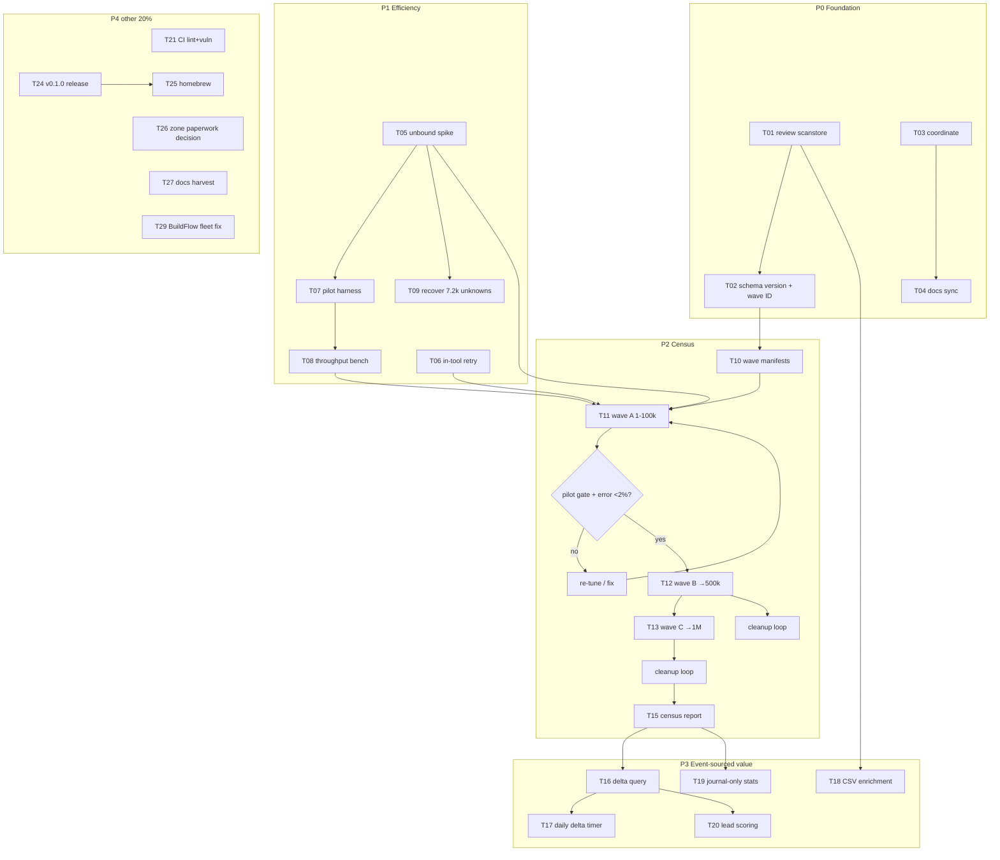

# Plan — Tranco top-1M Census: efficient + event-sourced

**2026-11-10 06:18 · google-domain-detector · PLAN ONLY (nothing implemented here)**

## Goal

Scan **all 1,000,000** Tranco domains (not just .de/.ch/.uk) efficiently —
one resumable pipeline instead of babysat multi-pass runs — and make the
event journal (already shipped by the concurrent session: `scan.started`,
`scan.domain_observed`, `scan.completed`, `--resume`, `replay`) the source
of truth for every downstream artifact: retries, deltas, stats, enrichment.

## What exists today (verified 2026-11-10 06:15)

- Scanner v0.x: 63,073 Tranco ∩ .de/.ch/.uk scanned (3 passes, public
  resolvers, 7,204 unknowns left). Detection = MX/SPF/DKIM/CNAME/NS/IP-range.
- Event store (concurrent session, plans T3/T4/T9): SQLite journal via
  go-cqrs-lite, per-domain evidence events, run linking via `--resume`,
  `replay` command, verdicts derived at read time (correct ES discipline).
- Proven bottleneck: public resolvers throttle bulk clients (~2 h sustained
  → timeouts). Unknowns are a resolver problem, not a tool problem.

## Pareto — what moves the needle

| Layer | Deliver 51% | The 1% |
| --- | --- | --- |
| **1 % → 51 %** | Local recursive resolver (unbound) + in-tool retry + journal-resume. Removes the throttle wall entirely; the 1M census becomes ONE resumable overnight command. Everything else is worthless if lookups fail. |
| **4 % → 64 %** | Pilot gate + tuned concurrency + staged waves (100k→1M) + unknown-cleanup loops. Turns "possible" into "complete first census of the top-1M". |
| **20 % → 80 %** | Delta detection on the journal (domains that ADOPTED Google between runs = the sales signal), enrichment CSV, journal-derived stats/reports. Turns data into product. |
| **other 20 % → 100 %** | Productization: CI lint/vuln, coverage, v0.1.0 release, tap, docs sync, zone-paperwork decision, fleet coordination. |

## Verschlimmbesser guards (non-negotiable)

1. **Evidence-schema version** stamped into `scan.domain_observed` BEFORE
   the census — a mid-series semantics change poisons every delta.
2. **Detection rules frozen per census wave** — rule changes only between
   waves, each wave carries its ruleset ID.
3. **Never blind-rescan** — resume from the journal; re-scans are explicit
   new waves with rationale.
4. **Pilot gate before every 10× scale jump** (error-rate + latency budget).
5. **Unbound runs user-scoped** (nix shell/container) — no system-wide
   resolver changes without explicit approval.
6. **Don't touch scanstore internals** until T01 review is done; the
   concurrent session's T-series plans are canonical — merge under them.
7. **Output formats frozen** (JSON keys, table columns) — downstream tooling.
8. **No new deps without a STACK.md row** (stack-drift-check gate).

## Master plan — tasks 30–100 min (sorted: importance/impact first, then effort, then customer value)

| # | Task | Phase | Impact | Effort | Customer value | Depends |
|---|------|-------|--------|--------|----------------|---------|
| T01 | Review scanstore session end-to-end (events, resume, replay, tests) — adopt as canonical | P0 | 10 | 60m | trust in the ledger | – |
| T02 | Evidence-schema-version + wave/ruleset ID in events (+ bump rule test) | P0 | 9 | 45m | durable deltas | T01 |
| T03 | Coordinate with concurrent session: plan ownership, TODO merge under T-series | P0 | 8 | 30m | no duplicated work | – |
| T04 | Docs sync: AGENTS architecture map + STACK row + TODO truth for scanstore | P0 | 6 | 30m | future sessions | T01 |
| T05 | Unbound spike: nix-shell unbound (user-scoped), forward config, probe via `--resolver` | P1 | 10 | 60m | removes throttle wall | – |
| T06 | In-tool transient retry (1×, timeout-class only) + unit tests | P1 | 9 | 90m | fewer manual passes | – |
| T07 | Pilot harness: slice-Nk + error-gate script + pre-flight doc | P1 | 7 | 45m | scale safety | T05 |
| T08 | Throughput benchmark: workers sweep (8/16/32/64) on 10k slice via unbound → params | P1 | 8 | 90m | 1M in hours not days | T05, T07 |
| T09 | Recover the 7,204 legacy unknowns (unbound + `--resume` on stored run) | P1 | 7 | 30m | closes .de/.ch/.uk census | T05, T06 |
| T10 | Tranco full-list import + wave IDs (ranks 1–100k, 100k–200k, …) in journal | P2 | 8 | 30m | deterministic waves | T02 |
| T11 | Wave A: ranks 1–100k (63k already observed → resume skips them) | P2 | 9 | 100m | first complete top-100k | T08, T10 |
| T12 | Wave B: ranks 100k–500k | P2 | 9 | 100m | census breadth | T11 gate |
| T13 | Wave C: ranks 500k–1M | P2 | 9 | 100m | FULL census | T12 gate |
| T14 | Unknown-cleanup loop per wave (retry until <0.5% unknown) | P2 | 7 | 45m/wave | data quality | T06 |
| T15 | Census report: global/per-TLD stats + coverage table, journal-derived, archived | P2 | 8 | 60m | the deliverable | T13, T14 |
| T16 | Delta query: verdict flips between runs (replay-based) + `--since` flag | P3 | 10 | 100m | THE sales signal | T02, T11 |
| T17 | Daily delta scan: Tranco refresh + only new/flipped domains (user timer) | P3 | 9 | 90m | always-fresh leads | T16 |
| T18 | Enrichment mode: input CSV + appended verdict columns (journal-backed) | P3 | 7 | 60m | CRM workflow | T01 |
| T19 | Stats/report from journal ONLY (replay as source of truth) | P3 | 6 | 60m | one truth | T15 |
| T20 | Lead scoring v1: workspace-certain × gcp × Tranco rank | P3 | 6 | 45m | prioritized list | T19 |
| T21 | CI: golangci-lint + govulncheck steps | P4 | 5 | 45m | supply chain | – |
| T22 | cli coverage 69% → 90% | P4 | 4 | 90m | maintainability | – |
| T23 | Input-parser fuzzing | P4 | 4 | 60m | robustness | – |
| T24 | v0.1.0 release via go-release skill | P4 | 5 | 90m | installability | T01–T04 |
| T25 | Homebrew tap entry | P4 | 3 | 45m | distribution | T24 |
| T26 | Zone-paperwork prep (DENIC RDS / Nominet DAA / SWITCH) — decision + drafts | P4 | 6 | 60m | path to 30M | T15 |
| T27 | docs-health HARVEST of this plan + status report into TODO/ROADMAP; FEATURES.md | P4 | 4 | 60m | doc truth | T04 |
| T28 | Watch first real CI run, fix findings | P4 | 3 | 45m | green CI | push |
| T29 | BuildFlow: push 06d333cfa, rebuild binary, reinstall hooks fleet-wide | P4 | 5 | 30m | fleet commits | approval |

## Micro-breakdown — every task ≤ 12 min

| Task | Micro-steps (each ≤12 min) |
|------|------------------------------|
| T01 | 1 read scanstore.go+events.go · 2 read replay.go+views.go · 3 read cli wiring · 4 run scanstore tests · 5 5-domain journal roundtrip by hand · 6 write verdict note in AGENTS |
| T02 | 1 add SchemaVersion const · 2 stamp payload + test · 3 add WaveID to scan.started · 4 bump-rule test · 5 CHANGELOG row |
| T03 | 1 read concurrent session's plan docs · 2 map overlaps T-series↔this plan · 3 write ownership note in TODO_LIST |
| T04 | 1 AGENTS architecture row scanstore · 2 STACK.md row go-cqrs-lite (why event store) · 3 stack-drift-check run · 4 TODO truth pass |
| T05 | 1 nix shell unbound · 2 minimal unbound.conf (recursion, no forward) · 3 start on 127.0.0.1:5353 · 4 `--resolver 127.0.0.1:5353` 5-domain probe · 5 record latency/error notes |
| T06 | 1 error-class classifier (timeout vs NXDOMAIN) · 2 retry wrapper in scan · 3 make retry injectable · 4 table tests · 5 race test · 6 README/CHANGELOG |
| T07 | 1 slice script (head -N of list) · 2 error-rate gate (fail >2%) · 3 pre-flight section in README · 4 dry-run wiring |
| T08 | 1 bench script (time × workers) · 2 run 8/16 · 3 run 32/64 · 4 qps+error table · 5 pick params, note in AGENTS |
| T09 | 1 extract unknowns from old run JSON · 2 rescan via unbound+resume · 3 merge+verify zero-class unknowns · 4 archive |
| T10 | 1 download full Tranco · 2 CRLF-safe filter · 3 wave-ID scheme doc · 4 journal import of wave manifests |
| T11 | 1 pilot 5k slice gate · 2 launch wave A via journal+resume · 3 monitor pass (error rate) · 4 cleanup loop · 5 checkpoint stats |
| T12 | 1 pilot gate · 2 launch · 3 monitor · 4 cleanup · 5 checkpoint |
| T13 | 1 pilot gate · 2 launch · 3 monitor · 4 cleanup · 5 checkpoint |
| T14 | 1 unknown-extract query · 2 trickle rescan · 3 measure <0.5% · 4 journal-only recount |
| T15 | 1 replay→stats script · 2 per-TLD table · 3 coverage/quality table · 4 archive reports/<date>-census/ · 5 summary in CHANGELOG |
| T16 | 1 domain-state projection query · 2 flip-diff between two run IDs · 3 `--since` CLI flag · 4 tests with two-run fixture · 5 README delta section |
| T17 | 1 Tranco refresh script (id+date) · 2 new-domain diff vs journal · 3 scan-new-only wiring · 4 user-timer unit · 5 delta report template |
| T18 | 1 CSV reader w/ header passthrough · 2 journal join by domain · 3 append columns writer · 4 quoted-CSV test · 5 README |
| T19 | 1 stats projection from replay · 2 replace ad-hoc JSON path in report script · 3 parity check old/new stats · 4 delete ad-hoc path |
| T20 | 1 score formula doc · 2 projection+rank join · 3 top-N export · 4 sanity vs workspace-certain.txt |
| T21 | 1 lint step · 2 vulncheck step · 3 pin versions · 4 watch run |
| T22 | 1 cover profile cli · 2 list gaps · 3–6 test batches per gap · 7 re-measure |
| T23 | 1 fuzz seed corpus (weird CSVs) · 2 FuzzParse loop 30s · 3 fix findings · 4 commit corpus |
| T24 | 1 CHANGELOG cut · 2 tag checklist (go-release skill) · 3 tag+push · 4 pkg.go.dev verify |
| T25 | 1 formula draft · 2 tap bump PR · 3 brew install test |
| T26 | 1 eligibility notes (DENIC/Nominet/SWITCH) · 2 data-use statement draft · 3 decision memo for Lars |
| T27 | 1 HARVEST pass (docs-health skill) · 2 TODO_LIST rewrite · 3 ROADMAP.md create · 4 FEATURES.md create |
| T28 | 1 push watch · 2 triage failures · 3 fix+push |
| T29 | 1 push BuildFlow fix · 2 nix rebuild+reinstall · 3 reinstall hook here · 4 verify manual commit |

## Execution graph

## Definition of done (the census)

- All 1,000,000 Tranco domains have a `scan.domain_observed` event from one
  wave, evidence-schema-versioned, unknowns < 0.5%.
- One command re-derives every stat from the journal; a second run a day
  later yields a delta report of new Google adopters without rescanning
  unchanged domains.
- reports/<date>-census/ archived; CHANGELOG carries the summary.

## Risk register

| Risk | Mitigation |
|------|------------|
| Public-resolver throttling persists via unbound | unbound recurses itself — load lands on authoritative NS spread worldwide; benchmark T08 proves it before waves |
| Journal bloat at 1M domains | SQLite ~1 evidence event/domain ≈ few hundred MB — acceptable; compaction decision after census |
| Concurrent session collision | T03 first; work only in agreed lanes; journal API treated as frozen |
| Detection change mid-census | Guard 1+2 (schema version, wave ruleset freeze) |
| Tranco list drifts between waves | waves defined by frozen manifest files, not live list |
