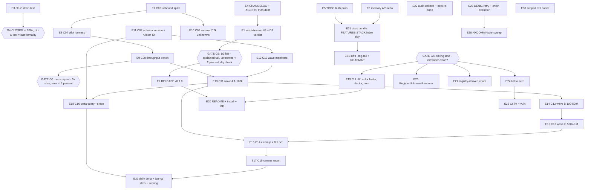

# Unified Execution Plan v3 — Ship v0.1.0, then Run the Census

**Written:** 2026-11-10 09:21 CET · **Repo state:** master @ b070655
(tree clean; another agent session active in CLI/render lanes — see G5)
· **Supersedes:** plan v2 (`2026-11-10_01-18_*`) for everything not yet
landed, and is the MERGE POINT the census plan
(`2026-11-10_06-18_tranco-1m-census-event-sourced.md`, guard 6) asked for:
that plan's T-series stays canonical downstream of the journal and is
referenced here as **C01–C29**; v2's T-series stays canonical for
scanstore/CLI internals and is referenced as **T#**. This plan's own items
are **E#**. One list, three lineages, no renumbering of anyone.
· **Inputs:** TODO_LIST.md (open rows verified 09:15), plan v2 + its two
execution status reports (`01-49`, `06-58`), census plan 06-18, live repo
state (T12 show/runs landed 80c1c60; T13 --color mid-flight/daemon-landed;
`--wave` flag already in ScanFlags from C02's start).
· **Freshness spot-checks (this session, live):** streaming jsonl ✓ landed;
`--resume` ✓ landed (3674285); Sink retry + 100k bench ✓ landed; show/runs
✓ landed; `--color` values tag present in working tree; no `-o` flag
(T1 decided against, STACK.md log entry 74).

## What changed since plan v2 was written (why v3 exists)

1. **The spine's mid-section landed:** T1–T4, T7–T11 (except ctrl-C test +
   G4 doc note), T12 — all green, daemon-committed or explicitly committed.
2. **T5 produced a finding, not a verdict:** run 1 (system resolver) had
   honest verdicts but a POISONED error tail (local resolver synthesized
   NXDOMAIN for live domains — 14/14 sampled false; two orphaned zombie scans
   were hammering it; killed). Run 2 (`--resolver 9.9.9.9`, 24 workers) was
   rate-limited into 2 157 timeouts → undercounted verdicts. G3 still OPEN.
3. **The census plan exists** and correctly claims everything downstream of
   the journal (unbound, waves, deltas, reports). Its efficiency thesis — own
   recursive resolver instead of public-resolver throttling — also solves the
   T5 problem class at the root.
4. **Read models are consumed** (show/runs, 80c1c60): the v2 "de-ghost"
   concern is closed.
5. **Docs accrued debt:** TODO_LIST has stale open rows (T2/T4/T10-era
   items marked open that are done), CHANGELOG lacks T7–T11 entries, AGENTS.md
   lacks the resolver-poisoning gotcha and the G4 numbers.

## Owner defaults (standing decisions encoded here, all reversible)

- **D1 — NXDOMAIN retry:** keep the pinned invariant (NXDOMAIN is
  authoritative, never retried). Mitigation is operational: bulk runs use
  an own recursive resolver (C05 unbound) or a trusted `--resolver`; a
  distressed third-party cache lying NXDOMAIN is documented, not coded
  around. Rationale: unverified-NXDOMAIN-retry would soften a correctness
  guarantee for every user to paper over one bad night with one bad cache.
- **D2 — push cadence:** owner directive (this session) says commit AND
  push; push both remotes (origin Forgejo + github mirror) at task
  boundaries. No history rewrites of pushed commits without approval.
- **D3 — G3 bar, codified:** the validation run passes the tag gate when
  (a) every error class in the tail is explained by taxonomy, (b)
  unknown-class errors (timeout+servfail+other) < 2 % of domains, and
  (c) the 10-verdict dig cross-check passes (already 10/10 ✓ from run 1).

## Gates

- **G3 — tag readiness:** run E1 passes the D3 bar. Until then no tag.
- **G4 — journal trust:** CLOSED for ≤100k events (append 18.7s/5 345/s,
  replay 2.0s/51 035/s, db 125 MiB, heap 15 MiB → 2.5M extrapolation ≈
  8 min append / ~3 GiB / ~50 s replay). Remaining formality: the ctrl-C
  drain integration test (E3). No whole-TLD run before E3 green.
- **G5 — sibling lane:** another agent session works this repo. Do not
  edit `internal/cli/*` or `internal/render/*` while their tree is dirty;
  re-check `git status` before every edit there. Their landed work is
  accepted as-is (no drive-by refactors inside their lanes mid-flight).
- **G6 — census pilot gates:** unchanged from census plan (error < 2 %
  on a 5k slice before every 10× jump; waves resume from the journal,
  never blind-rescan; evidence-schema version + ruleset ID frozen before
  wave A).
- **G7 — release ordering:** already satisfied (T1 decided pre-tag);
  recheck only that no breaking flag change sneaks in before the tag.

## Pareto breakdown

### The 1% that delivers 51% — SHIP IT (E1–E4)

The tool streams, resumes, journals, retries, explains its errors, and
serves its own journal (show/runs/replay). Every hour it stays untagged is
value evaporating. Four tasks: one honest validation run under the D3 bar,
the ctrl-C formality that closes G4, the CHANGELOG/AGENTS truth debt, and
the v0.1.0 release itself (tag, both remotes, GitHub release, proxy
check). ≈ 4 h, more than half of all remaining realizable value.

### The 4% that delivers 64% — MAKE THE CENSUS FEASIBLE (E7–E11 = C05–C09, C02)

An own recursive resolver removes the throttle wall that poisoned two T5
runs; the pilot harness and worker benchmark turn "maybe overnight" into
measured parameters; recovery of the 7 204 legacy unknowns proves the
pipeline on real data before the 1M commitment; the schema/wave stamping
(C02, already started — `--wave` flag exists) freezes detection semantics
so deltas mean something. ≈ 5 h.

### The 20% that delivers 80% — RUN IT AND READ IT (E12–E18 = C10–C16)

Waves A/B/C with pilot gates and cleanup loops; the census report; the
delta query (verdict flips between runs — THE sales signal). Plus the
usability pair that makes daily use pleasant (E19: color footer polish
landing now, doctor preflight, live progress) and the trust pair (E22
audit upkeep, E24 lint zero). This tier is where data becomes product.

### The other 20% (to 100%) — LONG TAIL (E20, E21, E23–E32)

README/install/tap, docs bundle (FEATURES/STACK/status index/tidy), zone
paperwork + crt.sh extractor, CI lint + vuln, renderer/enum cleanup, CSV
enrichment, scoped exit codes, NXDOMAIN pre-sweep, infra long-tail +
ROADMAP parking, daily delta timer, journal-only stats, lead scoring,
A/B redo and benches.

## Level 1 — comprehensive plan (30–100 min, ALL open TODO rows, sorted by importance/impact/effort/customer-value)

Canonical: T# = plan v2, C# = census plan, E# = new in v3. Lane: 🅐 = free
to execute now, 🅑 = sibling-session lane (G5), 🅒 = census-session lane,
👤 = owner action, 🔧 = other repo.

| #   | Task (canonical)                                                                                                                                                                                             | Tier | Impact     | Cust.value | Effort   | Gate        | Lane |
| --- | ------------------------------------------------------------------------------------------------------------------------------------------------------------------------------------------------------------ | ---- | ---------- | ---------- | -------- | ----------- | ---- |
| E1  | T5-final: validation run #3 (workers 8, timeout 8s, calm system resolver; fall back C05 unbound if tail > 2 %) + D3 verdict + CHANGELOG                                                                      | 1%   | High       | High       | 60m      | D3          | 🅐    |
| E2  | T6: RELEASE v0.1.0 — CHANGELOG cut, tag, both remotes, GitHub release, proxy/pkg.go.dev check, `nix run .#release` check, go-get pull-check, retract note                                                    | 1%   | Very high  | Very high  | 90m      | G3,G7       | 🅐    |
| E3  | T11-finish: ctrl-C drain integration test (hang-resolver + explicit cancel → partial run replays, run completed)                                                                                             | 1%   | High       | Medium     | 30m      | G4          | 🅐    |
| E4  | Truth debt: CHANGELOG entries T7–T11 + T12/T13; AGENTS.md — resolver-poisoning gotcha, G4/100k numbers, streaming/resume/ordering rows; stack-drift-check                                                    | 1%   | Medium     | Medium     | 30m      | —           | 🅐    |
| E5  | TODO truth pass: strike/redirect stale rows (T2 format-widen, T4 hardening, T1 -o, batch retry, memory row → guidance), docs-gates freshness first, harvest 06-58 report §f                                  | 4%   | Medium     | Medium     | 45m      | —           | 🅐    |
| E6  | Redo memory A/B (old buffered binary, PID-safe) + calm-network jsonl throughput note                                                                                                                         | 20%  | Low        | Low        | 30m      | —           | 🅐    |
| E7  | C05: unbound spike — user-scoped nix shell, 127.0.0.1:5353, probe via `--resolver`, latency/error notes                                                                                                      | 4%   | Very high  | High       | 60m      | —           | 🅒/🅐  |
| E8  | C07: pilot harness — slice-Nk script + error-rate gate (>2 % fails) + pre-flight doc                                                                                                                         | 4%   | High       | Medium     | 45m      | —           | 🅒/🅐  |
| E9  | C08: throughput benchmark — workers 8/16/32/64 on 10k slice via unbound → wave params into AGENTS                                                                                                            | 4%   | High       | Medium     | 90m      | G6          | 🅒    |
| E10 | C09: recover 7 204 legacy unknowns (.de/.ch/.uk) via unbound + `--resume`; archive                                                                                                                           | 4%   | High       | High       | 30m      | E7          | 🅒    |
| E11 | C02: evidence-schema version + ruleset ID stamped in events (+ `--wave` already started — finish stamping, bump-rule test)                                                                                   | 4%   | High       | Medium     | 45m      | G6          | 🅑/🅒  |
| E12 | C10: Tranco full-list import + frozen wave manifests (rank bands)                                                                                                                                            | 20%  | High       | High       | 30m      | E11         | 🅒    |
| E13 | C11: wave A ranks 1–100k (63k already observed — resume skips) + pilot gate + cleanup                                                                                                                        | 20%  | Very high  | Very high  | 100m     | E9,E12,G6   | 🅒    |
| E14 | C12: wave B ranks 100k–500k + gate + cleanup                                                                                                                                                                 | 20%  | Very high  | Very high  | 100m     | E13 gate    | 🅒    |
| E15 | C13: wave C ranks 500k–1M + gate + cleanup → full census                                                                                                                                                     | 20%  | Very high  | Very high  | 100m     | E14 gate    | 🅒    |
| E16 | C14: unknown-cleanup loop per wave until < 0.5 % unknown                                                                                                                                                     | 20%  | High       | High       | 45m/wave | E13+        | 🅒    |
| E17 | C15: census report (journal-derived, per-TLD stats, coverage) archived under reports/                                                                                                                        | 20%  | Very high  | Very high  | 60m      | E15,E16     | 🅒    |
| E18 | C16: delta query — verdict flips between runs + `--since` flag + two-run fixture tests (the sales signal)                                                                                                    | 20%  | Very high  | Very high  | 100m     | E11,E13     | 🅒/🅑  |
| E19 | T13-finish + T15 + T16: color/SetFooter/Title/AddRowChecked completion, WithDoctorCheck preflight, nom live progress (TTY-only)                                                                              | 20%  | Medium     | High       | 90m      | G5          | 🅑    |
| E20 | T14: README honest (JSON array claim, streaming/resume/query-your-journal sections) + install section + Homebrew tap post-tag                                                                                | tail | Medium     | High       | 45m      | E2          | 🅐    |
| E21 | T17-docs: FEATURES refresh (streaming/resume/show/runs/replay), STACK rows check, docs/status index in README, `go mod tidy`, docs-gates green                                                               | tail | Medium     | Medium     | 45m      | —           | 🅐    |
| E22 | T18: audit upkeep — re-verify citations vs HEAD, cqrs/cqrs-htmx re-audit (premise flipped), verified-at-commit headers (22 reports), re-screenshot                                                           | tail | Medium     | Low        | 60m      | —           | 🅐    |
| E23 | T19: DENIC retry (rate-limited) + crt.sh fallback extractor + fixture test + README bulk docs + ccTLD constraint review                                                                                      | tail | High(long) | High(long) | 90m      | —           | 🅐    |
| E24 | T20: lint cleanup to zero (err113 ×N, cyclop, wrapcheck, errcheck, tagalign, varnamelen, exhaustive, makezero, nilnil, tagliatelle policy calls)                                                             | tail | Medium     | Low        | 90m      | G5          | 🅐    |
| E25 | T21+C21: CI steps — cmdguard-lint (expect 0), golangci-lint, govulncheck; watch first run                                                                                                                    | tail | Medium     | Medium     | 45m      | E24         | 🅐    |
| E26 | T22.3: RegisterUnknownRenderer(FormatJSON, dto) — dissolve cli.go JSON special-case (22.1/22.2 resolved-decided-against by T1)                                                                               | tail | Medium     | Medium     | 30m      | G5          | 🅑    |
| E27 | T23: registry-derived `values:` enum (FormatsForShape) + drift-proof test                                                                                                                                    | tail | Medium     | Low        | 45m      | G5          | 🅑    |
| E28 | T24: NXDOMAIN/A-existence pre-sweep `--pre-filter` + volume measurement (gates: T9 ✓, G4 ✓, T19 lead-time)                                                                                                   | tail | High(long) | High(long) | 90m      | E23         | 🅐    |
| E29 | T25: CSV enrichment = C18 (census lane owns; journal-backed column append)                                                                                                                                   | tail | Medium     | Medium     | 60m      | —           | 🅒    |
| E30 | T26: scoped exit codes in ranges (75 fetch / 65 corrupt) + tests + audit note                                                                                                                                | tail | Low        | Medium     | 30m      | —           | 🅐    |
| E31 | T27+C27: infra long-tail — TimeoutMiddleware, describe contract test, vendorHash.nix, version-freshness guard, docs-gates cache-key investigation, ETag, ROADMAP.md parking (CAA watch, compaction decision) | tail | Low        | Low        | 90m      | E21         | 🅐    |
| E32 | C17+C19+C20: daily delta timer, journal-only stats (delete ad-hoc JSON path), lead scoring v1 (workspace-certain × gcp × Tranco rank)                                                                        | tail | High       | Very high  | 100m     | E18,E17     | 🅒    |
| E33 | C24-equivalent: coverage 69 % → 90 % (cli), input fuzzing (C23)                                                                                                                                              | tail | Low        | Low        | 90m      | —           | 🅐    |
| E34 | C29: BuildFlow#56 fleet fix — push toolchain-bump, rebuild binary, reinstall hooks (🔧 other repo, approval-gated)                                                                                           | tail | Medium     | Low        | 30m      | 👤 approval | 🔧   |
| E35 | Owner actions reminder: send Nominet email + SWITCH TSIG request (drafts in docs/zone-data/)                                                                                                                 | tail | High(long) | High(long) | 👤       | —           | 👤   |

**Coverage check (every open TODO_LIST row → exactly one E-task):**
census T02→E11 · T05→E7 · T07→E8 · T08→E9 · T09→E10 · T10→E12 · T11–13→E13–15 ·
T14→E16 · T15→E17 · T16→E18 · resolver-guidance→E7 (README part E20) ·
CAA→E31 ROADMAP · CSV enrichment→E29 · DENIC/Nominet/SWITCH→E23+E35 ·
pre-filter→E28 · memory-row→E5 (strike; guidance lands in E20 README) ·
release tag→E2 · tap→E20 · nix-release check→E2 · format-widen (stale)→E5 ·
atomic-write row (stale, landed)→E5 · --color/footer/AddRowChecked→E19 ·
doctor→E19 · -o decision (stale, decided)→E5 · cmdguard-lint CI→E25 ·
audit upkeep→E22 · AddRowChecked/Title→E19 · WithExample (landed T4)→E5 ·
verified-at-commit→E22 · README install→E20 · STACK rows→E21 · tidy→E21 ·
WithCLICommit (landed T4)→E5 · RegisterUnknownRenderer→E26 · lint→E24 ·
status index→E21 · freshness guard→E31 · TimeoutMiddleware→E31 ·
FormatsForShape→E27 · v2-T5→E1 · v2-T11→E19 · v2-T13(nom)→E19 ·
v2-T20(-o)→resolved by T1/E5 · v2-T22→E27 · v2-T25→E30 · v2-T27→E31 ·
mermaid-check (done)→E5 strike · scanstore sink-retry (done)→E5 strike ·
error-taxonomy (done)→E5 strike.

**Sequencing:** E1 can start immediately (binary-only). E3+E4+E5 while it
runs. E2 the moment E1 passes D3. Census lane: E7 parallel (independent),
E8→E9→E10, E11 before E12, waves gated. Sibling lane (🅑) proceeds at its
own pace; nothing in 🅐 blocks on it except E24/E26/E27 (post-landing).

## Level 2 — fine breakdown (max 12 min per task, sorted within each L1 task; global order = L1 order)

| ID        | Task                                                                                                                                                  | Imp | Eff  | Gate    |
| --------- | ----------------------------------------------------------------------------------------------------------------------------------------------------- | --- | ---- | ------- |
| 1.1       | Verify no zombie scanners (`ps`), resolver calm (spot dig ×3)                                                                                         | H   | 3m   | —       |
| 1.2       | Launch run #3: 3 645-domain .ch slice, workers 8, timeout 8s, event store + json, rusage capture                                                      | H   | 5m   | —       |
| 1.3       | Error-tail readout vs D3 bar (classes explained, unknowns < 2 %)                                                                                      | H   | 8m   | —       |
| 1.4       | Replay run #3; python content-diff vs live output (0 diffs required)                                                                                  | H   | 8m   | —       |
| 1.5       | Dig cross-check 10 verdicts incl. 2 nxdomain-class (public resolvers)                                                                                 | H   | 10m  | —       |
| 1.6       | Compare verdict counts vs runs 1+2; sanity-explain deltas                                                                                             | M   | 8m   | —       |
| 1.7       | If tail > 2 %: rerun via unbound spike (E7 early) instead of third public attempt                                                                     | H   | 12m  | —       |
| 1.8       | Verdict note (G3 PASS/FAIL) + CHANGELOG entry                                                                                                         | H   | 8m   | —       |
| 2.1       | Cut CHANGELOG 0.1.0 section (all Unreleased entries folded)                                                                                           | H   | 10m  | G3      |
| 2.2       | Full direct gates on release commit (build+vet+test -race, docs-gates, nix build)                                                                     | H   | 10m  | G3      |
| 2.3       | Annotated tag v0.1.0                                                                                                                                  | H   | 3m   | G3      |
| 2.4       | Push master+tag to origin AND github                                                                                                                  | H   | 5m   | G3      |
| 2.5       | GitHub Release notes (gh, github remote)                                                                                                              | H   | 10m  | G3      |
| 2.6       | Module proxy + pkg.go.dev propagation check                                                                                                           | M   | 8m   | G3      |
| 2.7       | `nix run .#release` wiring check; `go get` pull-check in scratch dir                                                                                  | M   | 10m  | G3      |
| 2.8       | Rollback readiness note (retract plan) in CHANGELOG                                                                                                   | M   | 4m   | G3      |
| 3.1       | ctrl-C test: hang-resolver + explicit cancel, event store on, assert partial replays                                                                  | H   | 12m  | G4      |
| 3.2       | Assert run completed (CompleteScan on WithoutCancel) + counts match observations                                                                      | H   | 8m   | G4      |
| 3.3       | G4 verdict + 100k numbers into AGENTS.md gotcha section                                                                                               | M   | 10m  | G4      |
| 4.1       | CHANGELOG: streaming jsonl (T7), chunked input + streaming replay (T8), resume (T9)                                                                   | M   | 10m  | —       |
| 4.2       | CHANGELOG: sink retry + 100k bench, show/runs, error-taxonomy cross-link                                                                              | M   | 8m   | —       |
| 4.3       | AGENTS: resolver-poisoning gotcha (lying cache NXDOMAIN, --resolver/unbound guidance)                                                                 | H   | 10m  | —       |
| 4.4       | AGENTS: package-map row update (domains.go, show.go) + ordering contract row                                                                          | M   | 8m   | —       |
| 4.5       | stack-drift-check.sh run; STACK row for any unlisted dep                                                                                              | M   | 6m   | —       |
| 5.1       | docs-gates freshness pre-flight (candidates file)                                                                                                     | M   | 5m   | —       |
| 5.2       | Strike done rows: format-widen, atomic-write, T4-hardening, -o-decision, WithCLICommit, WithExample, batch-retry, sink-retry, taxonomy, mermaid-check | M   | 12m  | —       |
| 5.3       | Rewrite memory row → "buffered formats materialize; bulk = jsonl" guidance; CAA → ROADMAP pointer                                                     | M   | 6m   | —       |
| 5.4       | Harvest 06-58 report §f items not yet covered (A/B redo→E6, jsonl bench→E6, ErrNoRuns UX→E31, describe eyeball→E31)                                   | M   | 10m  | —       |
| 5.5       | docs-gates run . green                                                                                                                                | M   | 7m   | —       |
| 6.1       | Re-run old binary on 50k list (PID-safe, no pkill patterns), rusage                                                                                   | L   | 12m  | —       |
| 6.2       | Record before/after table (40 MiB flat vs old) into plan doc/CHANGELOG                                                                                | L   | 8m   | —       |
| 6.3       | Calm-network jsonl throughput note (50k re-run if needed)                                                                                             | L   | 10m  | —       |
| 7.1       | nix shell unbound + minimal unbound.conf (recursion, user-scoped, 127.0.0.1:5353)                                                                     | H   | 12m  | —       |
| 7.2       | Start unbound; 5-domain probe via `--resolver 127.0.0.1:5353`                                                                                         | H   | 8m   | —       |
| 7.3       | Latency/error notes vs 9.9.9.9 baseline; decision: waves on unbound                                                                                   | H   | 12m  | —       |
| 7.4       | Kill-safety: unbound lifecycle script (start/stop) under scripts/                                                                                     | M   | 10m  | —       |
| 7.5       | AGENTS/README note: bulk runs prefer own resolver (D1 rationale)                                                                                      | M   | 8m   | —       |
| 8.1       | slice script (head -N of Tranco list) under scripts/                                                                                                  | M   | 8m   | —       |
| 8.2       | Error-rate gate script: fail > 2 % (parses stderr summary/jsonl error kinds)                                                                          | H   | 12m  | —       |
| 8.3       | Pre-flight doc section (README) + dry-run wiring                                                                                                      | M   | 10m  | —       |
| 8.4       | Test the harness on the 3 645 .ch slice (should pass post-E1)                                                                                         | H   | 12m  | —       |
| 9.1       | Bench script: time × workers on 10k slice via unbound                                                                                                 | M   | 10m  | G6      |
| 9.2       | Run 8/16 workers; record qps + error rates                                                                                                            | H   | 12m  | G6      |
| 9.3       | Run 32/64 workers; record                                                                                                                             | H   | 12m  | G6      |
| 9.4       | Pick wave params; note in AGENTS (workers, timeout, expected wall/wave)                                                                               | H   | 10m  | G6      |
| 10.1      | Extract 7 204 unknowns from stored run JSON                                                                                                           | H   | 8m   | E7      |
| 10.2      | Rescan via unbound + `--resume latest`                                                                                                                | H   | 12m  | E7      |
| 10.3      | Verify unknown-class collapse; merge + archive                                                                                                        | H   | 10m  | E7      |
| 11.1      | Finish C02: SchemaVersion const + stamp into domain_observed payload (coordinate 🅑: --wave flag exists)                                               | H   | 12m  | G6      |
| 11.2      | Ruleset ID (classify rules hash/ID) into scan.started; bump-rule test                                                                                 | H   | 12m  | G6      |
| 11.3      | CHANGELOG + AGENTS event-contract note                                                                                                                | M   | 8m   | G6      |
| 12.1      | Download full Tranco list; CRLF-safe filter                                                                                                           | H   | 10m  | E11     |
| 12.2      | Wave-ID scheme + frozen manifest files under data/waves/                                                                                              | H   | 12m  | E11     |
| 12.3      | Manifest sanity test (disjoint bands, full coverage, count checks)                                                                                    | M   | 10m  | E11     |
| 13.1      | Pilot gate: 5k slice, error < 2 % via E8 harness                                                                                                      | H   | 12m  | G6      |
| 13.2      | Launch wave A (resume skips 63k observed)                                                                                                             | H   | 10m  | G6      |
| 13.3      | Monitor pass (error rate, journal growth, RSS)                                                                                                        | H   | 12m  | G6      |
| 13.4      | Cleanup loop to < 0.5 % unknown (E16 first application)                                                                                               | H   | 12m  | G6      |
| 13.5      | Checkpoint stats into wave notes                                                                                                                      | M   | 8m   | G6      |
| 14.1–14.5 | Wave B = pilot gate, launch, monitor, cleanup, checkpoint (same shape as 13.x)                                                                        | H   | 100m | E13     |
| 15.1–15.5 | Wave C = same shape → full census                                                                                                                     | H   | 100m | E14     |
| 16.1      | Unknown-extract query from journal (per wave)                                                                                                         | M   | 10m  | E13+    |
| 16.2      | Trickle rescan (low workers) of unknowns only                                                                                                         | M   | 12m  | E13+    |
| 16.3      | Journal-only recount; < 0.5 % assertion                                                                                                               | M   | 10m  | E13+    |
| 17.1      | replay→stats script (journal as only source)                                                                                                          | H   | 12m  | E15,E16 |
| 17.2      | Per-TLD + global tables                                                                                                                               | H   | 12m  | E15,E16 |
| 17.3      | Coverage/quality table (unknown %, per-wave)                                                                                                          | M   | 10m  | E15,E16 |
| 17.4      | Archive reports/<date>-census/; summary in CHANGELOG                                                                                                  | H   | 10m  | E15,E16 |
| 18.1      | Domain-state query across runs (journal walk, verdict per run)                                                                                        | H   | 12m  | E11,E13 |
| 18.2      | Flip-diff between two run IDs (adopted/left)                                                                                                          | H   | 12m  | E11,E13 |
| 18.3      | `--since` flag on replay/show (G5: coordinate cli edits)                                                                                              | H   | 12m  | E11,E13 |
| 18.4      | Two-run fixture test                                                                                                                                  | H   | 12m  | E11,E13 |
| 18.5      | README delta section                                                                                                                                  | M   | 8m   | E11,E13 |
| 19.1      | Verify sibling's --color/SetFooter landed; gap-list vs v2 T13 (Title, AddRowChecked, footer tests)                                                    | M   | 10m  | G5      |
| 19.2      | Fill T13 gaps + tests (csv/tsv/markdown footer, Title)                                                                                                | M   | 12m  | G5      |
| 19.3      | WithDoctorCheck scaffold + resolver reachability check                                                                                                | M   | 12m  | G5      |
| 19.4      | Ranges feed fetch+parse check + doctor_test with fakes                                                                                                | M   | 12m  | G5      |
| 19.5      | nom progress: evaluate go-output/nom API, wire worker feed, TTY gate, pipe-quiet test                                                                 | M   | 12m  | G5      |
| 20.1      | README: fix "one line per domain" JSON claim (single-line array); document completion-order jsonl                                                     | H   | 5m   | E2      |
| 20.2      | Install section (nix/brew/go install) + link check                                                                                                    | H   | 12m  | E2      |
| 20.3      | Quickstart incl. --event-store/--resume/show/runs/replay                                                                                              | M   | 10m  | E2      |
| 20.4      | Homebrew formula draft in homebrew-tap repo + CI verification                                                                                         | H   | 12m  | E2      |
| 21.1      | FEATURES.md refresh (streaming, resume, journal, show/runs, taxonomy) — create if missing                                                             | M   | 12m  | —       |
| 21.2      | STACK.md rows audit vs go.mod direct deps                                                                                                             | M   | 8m   | —       |
| 21.3      | docs/status index section in README                                                                                                                   | L   | 8m   | —       |
| 21.4      | `go mod tidy` sweep + buildflow/gomod-check green                                                                                                     | M   | 6m   | —       |
| 21.5      | docs-gates run . green                                                                                                                                | M   | 7m   | —       |
| 22.1      | Re-audit go-cqrs-lite + cqrs-htmx verdicts (premise flipped: direct dep, system composition)                                                          | M   | 12m  | —       |
| 22.2      | Re-verify all audit citations vs current HEAD; fix drift                                                                                              | M   | 12m  | —       |
| 22.3      | "Verified against commit X" headers on 22 reports                                                                                                     | M   | 10m  | —       |
| 22.4      | Re-screenshot audit index + href re-check                                                                                                             | L   | 8m   | —       |
| 22.5      | Check sibling subagent reports (akiko/celeste) diff if present                                                                                        | L   | 8m   | —       |
| 23.1      | DENIC RDS research retry (was rate-limited); write denic-de.md                                                                                        | H   | 12m  | —       |
| 23.2      | crt.sh extractor script (pull certs, dedupe registrable .ch)                                                                                          | M   | 12m  | —       |
| 23.3      | Extractor test (fixture JSON) + README bulk docs wiring                                                                                               | M   | 12m  | —       |
| 23.4      | ccTLD data-usage constraint review note                                                                                                               | M   | 10m  | —       |
| 24.1      | golangci run for the REAL finding list (LSP counts stale)                                                                                             | H   | 10m  | G5      |
| 24.2      | err113 fixes (static sentinels) across domain/input/ranges/cli/scanstore/render                                                                       | M   | 12m  | G5      |
| 24.3      | cyclop: extract helpers from scan.Run/ScanDomain                                                                                                      | M   | 12m  | G5      |
| 24.4      | wrapcheck/nilnil/makezero/exhaustive fixes or documented suppressions                                                                                 | M   | 12m  | G5      |
| 24.5      | errcheck Fprintf + varnamelen + tagalign + tagliatelle POLICY (snake_case json is deliberate)                                                         | M   | 12m  | G5      |
| 24.6      | Full buildflow (or direct) gate incl. -race green                                                                                                     | H   | 12m  | G5      |
| 25.1      | ci.yml: cmdguard-lint + golangci + govulncheck steps, pinned versions                                                                                 | L   | 10m  | E24     |
| 25.2      | Local run, expect 0 findings; fix or document                                                                                                         | L   | 12m  | E24     |
| 25.3      | Watch first CI run post-push; triage                                                                                                                  | L   | 10m  | E24     |
| 26.1      | RegisterUnknownRenderer(FormatJSON, dto); route json through registry; delete special-case                                                            | M   | 12m  | G5      |
| 26.2      | Golden/describe updates + README/audit note                                                                                                           | M   | 10m  | G5      |
| 27.1      | FormatsForShape investigation (go-output registry introspection)                                                                                      | M   | 10m  | G5      |
| 27.2      | Generate flag values from registry; drop hardcoded enum                                                                                               | M   | 12m  | G5      |
| 27.3      | Drift-proof test: registry == enum                                                                                                                    | M   | 10m  | G5      |
| 28.1      | Design parallel A-existence pass (bounded memory, reuses feeder)                                                                                      | M   | 12m  | E23     |
| 28.2      | Implement sweep phase + `--pre-filter` flag (G5)                                                                                                      | M   | 12m  | E23     |
| 28.3      | Volume-reduction measurement on sample                                                                                                                | M   | 12m  | E23     |
| 28.4      | Worker-pool bounds + tests                                                                                                                            | H   | 12m  | E23     |
| 29.1–29.4 | C18 CSV enrichment: header passthrough reader, journal join, append writer, quoted/ragged tests                                                       | M   | 60m  | —       |
| 30.1      | Wrap ranges fetch/parse with family constructors                                                                                                      | L   | 10m  | —       |
| 30.2      | Exit-code test (75 fetch / 65 corrupt) + audit/AGENTS note                                                                                            | L   | 12m  | —       |
| 31.1      | TimeoutMiddleware optional whole-run budget (G5)                                                                                                      | L   | 10m  | E21     |
| 31.2      | describe contract test (battery output shape)                                                                                                         | L   | 10m  | E21     |
| 31.3      | vendorHash extraction to vendorHash.nix                                                                                                               | L   | 12m  | E21     |
| 31.4      | Version-freshness guard for audit reports                                                                                                             | L   | 12m  | E21     |
| 31.5      | docs-gates cache-key investigation; ETag revalidation if polled >daily; ErrNoRuns store-path UX                                                       | L   | 12m  | E21     |
| 31.6      | ROADMAP.md: CAA watch, journal compaction post-census, deferred items                                                                                 | M   | 12m  | E21     |
| 32.1      | C17 daily delta: Tranco refresh script + new-domain diff vs journal                                                                                   | M   | 12m  | E18     |
| 32.2      | C19 journal-only stats; delete ad-hoc JSON path; parity check                                                                                         | M   | 12m  | E17     |
| 32.3      | C20 lead scoring v1: score doc, projection+rank join, top-N export, sanity check                                                                      | M   | 12m  | E32.2   |
| 33.1      | Coverage profile (cli 69 %); gap list                                                                                                                 | L   | 10m  | —       |
| 33.2–33.4 | Test batches per gap; input fuzzing corpus + 30s FuzzParse                                                                                            | L   | 80m  | —       |
| 34.1      | BuildFlow repo: push toolchain bump, rebuild, reinstall hooks (approval-gated)                                                                        | M   | 30m  | 👤      |

**Counts:** 35 L1 tasks (ship 4 · feasibility 5 · census/data 10 · polish/docs 8 · tail 8) · **≈ 150 L2 micro-tasks** · est. ≈ 26 h plus census wall-clock.

## Execution graph

## Errata / corrections applied to plan v2 (Step 0 duty)

- **Landed since v2 and struck from this plan:** T1–T4, T7–T10, T12, and
  T11 except its two formalities (E3/E4), T17-partial (Nominet/SWITCH
  research + zone-data docs), T19-partial (crt.sh still open → E23).
- **T5 split:** the "validation run" became three runs because of the
  resolver-poisoning discovery (06-58 report §d); the D3 bar codifies what
  "clean" means so this cannot drift again.
- **T22 re-scoped:** T1 rejected `-o` (STACK.md decision log), so 22.1/22.2
  are resolved-as-decided-against; only the renderer cleanup (22.3) remains
  as E26.
- **T25/CSV enrichment re-homed:** census plan owns it (C18) — E29 points
  there; no duplicate implementation.
- **T9-resume/T7-streaming/T8-input:** all landed; v2's remaining scale
  concerns now live in the census plan's efficiency thesis instead.
- **Deliberately NOT planned:** refactors of the sibling session's in-flight
  CLI/render work (G5); any NXDOMAIN-retry code (D1); removing the read
  models (they are consumed now); BuildFlow internals beyond E34 (other
  repo, approval-gated).

## Post-plan note (docs-health)

E5 is the TODO_LIST sync for this plan; the census plan's rows already
carry correct ownership pointers. This file is the snapshot; TODO_LIST
stays the living source.
