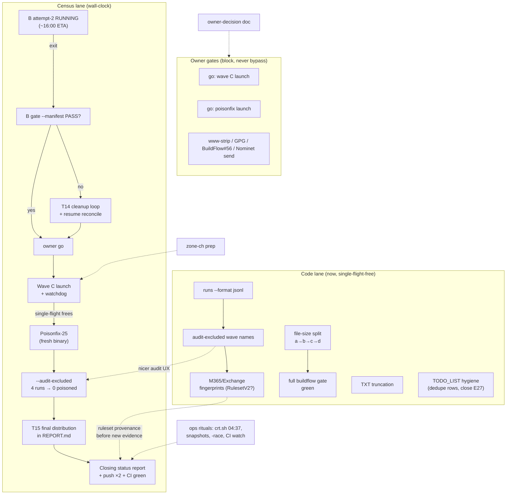

# SUPERB Pareto Plan — Census Closeout & Signal Usability

**Written:** 2026-11-14 00:42 CET · **Mandate:** owner directive (Pareto
breakdown, two-granularity plan, execution graph, then execute).
**Input universe:** TODO_LIST.md open rows (2026-11-14 00:42 read) + the
21-15 handoff report's §f (40 items) + 19-50/17-20 report remainders,
deduped and reality-checked against code/CHANGELOG per docs-health Step 0.

## Ground rules (the Verschlimmbesser guardrails)

1. **Single-flight law**: exactly ONE `gdd scan` at all times
   (`pgrep -f 'gdd[^ ]* scan'` before every launch; pattern tolerates
   dated binaries). Wave B attempt-2 (`--resume 01M79XW7SF9…`) is
   running now; nothing launches until it exits.
2. **Never edit a script a running instance executes** (byte-offset
   corruption) — census-wave.sh, gate, watchdog are frozen until B is
   done; replace-by-new-inode only.
3. **Ruleset provenance is append-only**: adding detection rules
   (M365/Exchange) means a NEW `classify.Ruleset` value, never editing
   RulesetV1 semantics — journal evidence must stay attributable.
4. **Deliberate non-fixes stay non-fixed** (E003, B005, the A032
   journal-surface law, GCP = cloud.json-only, free-Gmail never
   upgrades to Workspace). The plan does not relitigate them.
5. **Owner gates are real gates**: poisonfix launch, wave-C auto-chain,
   www-strip policy, Nominet email, GPG, BuildFlow#56 — prepared, not
   executed, without owner go.

## Errata (stale-backlog corrections found while verifying)

- **E27 `output.FormatsForShape` row (TODO_LIST:351) is SUPERSEDED**:
  T22 landed the capability as `render.SupportedFormats()` +
  `TestFormatEnumsMatchRegistry` (internal/render/render.go:171,
  internal/cli/formats_test.go:28). Close as done-by-T22.
- **file-size debt is in TODO_LIST TWICE** (lines 213-220 and 225-228,
  mine and the dedup-audit session's). One canonical row survives the
  hygiene cycle (T17); the plan tracks the work once (Q1).
- The 21-15 §f list and TODO_LIST overlap ~80% — this plan is the
  merged, deduplicated canon.

## Pareto analysis — what IS the result?

The product is **trustworthy census verdicts feeding the Kith CRM sales
signal**. Everything ranks against that. Wave B attempt-2 completes
~16:00 today; wall-clock gates dominate the critical path, so the plan
runs TWO lanes: the census lane (supervision rituals, spread over the
day) and the code lane (single-flight-independent, executable NOW).

### The 1% → 51%: the census chain closes

Five supervision/launch actions turn a running scan into TRUSTWORTHY
data: B completes → B gate passes → C launches → poisonfix-25 runs →
audit reports 0 poisoned. Every other deliverable (T15, CRM, deltas)
derives from this. Combined active effort < 4 hours; the rest is
wall-clock. **Nothing else in the repo comes close.**

### The 4% → 64%: the signal becomes usable

+13% comes from making the data consumable and the operator unblocked:
`runs --format` jsonl with full IDs (the poisonfix derivation needed raw
SQL!), `--audit-excluded` accepting wave names (the audit ritual runs
repeatedly), T15's final distribution section (the actual deliverable
doc), rank-band calibration (B's 2.8% `.cn` class must not cry wolf), and
**M365/Exchange fingerprints** — the single highest code-value item:
classify-only, table-tested, doubles the product's addressable answer
("which email stack?" instead of "Google only?").

### The 20% → 80%: the pipeline sustains itself

+16%: the file-size split (9 files block a green full gate), TXT
truncation investigation (the hostile-TXT decode-death class was real —
it wedged wave B once), audit upkeep (libs render proof + cqrs verdict
re-audit), the operational ritual bundle (crt.sh 04:37 verification,
snapshot flow, single-flight confirmation, full `-race` on pushed HEAD,
CI watch), the TODO_LIST hygiene cycle (518 lines, ~85% struck rows —
the backlog is becoming unscannable), and the STACK/CHANGELOG/describe
coherence pass.

### The rest → 100%

asciinema demo, io-history ratchet, zone-ch scan prep, CRM-delta/enrich
ment/registrant-dedup framing, owner-decision packaging, reports/LSP
hygiene. Plus the explicitly-parked (ROADMAP: lead scoring, flip
alerting, journal compaction, CAA — no owner, not commitments) and the
resolved-impossible (DENIC .de zone access).

---

## Table 1 — Comprehensive plan (30–100 min tasks, ≤27, ALL todos)

Sort: importance/impact/effort/customer-value. Lanes: **C** = census
(wall-clock gated), **U** = usability code (now), **Q** = sustain
(now), **R** = rest (now/owner). "Go" = owner gate.

| #  | Task                                                        | Lane | Est  | Impact | Effort | Value | Depends on |
|----|-------------------------------------------------------------|------|------|--------|--------|-------|------------|
| C1 | Monitor B attempt-2 to completion; watchdog/heartbeat watch | C    | 60m† | 10     | 2      | 10    | wall clock |
| C2 | Verify B's auto-gate PASS (`--expect-skip`); T14 loop if not | C    | 45m  | 10     | 3      | 10    | C1         |
| C3 | Launch wave C (fresh, gdd-20261113b, w4/10s, 5354, tcp) + watchdog | C | 45m | 9 | 3 | 9 | C2 pass, Go |
| C4 | Poisonfix-25 pass (fresh binary, audit-derived list)         | C    | 45m  | 10     | 3      | 10    | single-flight free, Go |
| C5 | Closure proof: `--audit-excluded` 4 runs → **0 poisoned**; snapshots flowing | C | 30m | 10 | 2 | 10 | C4 |
| U1 | `runs --format` jsonl, FULL run IDs (render wiring + tests + smoke on census.db) | U | 60m | 8 | 4 | 8 | — |
| U2 | `--audit-excluded` accepts wave NAMES (map wave→run IDs from RunViews) | U | 60m | 7 | 4 | 7 | — |
| U3 | T15 final distribution section in REPORT.md (journal-derived, replay cmd pinned) | U/C | 60m | 9 | 4 | 9 | C5 |
| U4 | Poller rank-band unknown-rate expectations (calibrate on B pass-1) | U | 45m | 6 | 3 | 6 | C1 data |
| U5 | M365/Exchange fingerprints (outlook MX/SPF includes; classify + table tests; **Ruleset bump decision**) | U | 90m | 9 | 5 | 9 | owner-confirm ruleset |
| Q1a| File-size split: scanstore.go (378) + scanstore_test.go (587) | Q | 60m | 5 | 4 | 4 | — |
| Q1b| File-size split: replay.go (489)                             | Q    | 45m  | 5      | 4      | 4     | — |
| Q1c| File-size split: cli.go (769) scan/replay/show wiring        | Q    | 100m | 5      | 5      | 4     | — |
| Q1d| File-size split: 6 test files (mechanical) + full gate green | Q    | 100m | 5      | 4      | 4     | Q1a-c      |
| Q2 | TXT truncation investigation (cloudflare "cannot unmarshal" class) | Q | 60m | 6 | 4 | 6 | — |
| Q3 | Audit upkeep: docs/review/libs render proof + go-cqrs-lite/cqrs-htmx verdict re-audit | Q | 60m | 5 | 4 | 4 | — |
| Q4 | Operational ritual bundle: crt.sh 04:37 verify + snapshot check + single-flight pgrep habit + full `-race` on HEAD + CI watch | Q | 60m | 6 | 3 | 5 | — |
| Q5 | TODO_LIST hygiene: docs-health VERIFY/HARVEST cycle (90+ struck rows; merge duplicate file-size rows; close E27) | Q | 60m | 5 | 3 | 4 | — |
| Q6 | STACK.md go-codec row + CHANGELOG Unreleased coherence + describe battery eyeball | Q | 45m | 4 | 3 | 3 | — |
| R1 | asciinema/GIF README demo (E20)                              | R    | 90m  | 4      | 5      | 4     | — |
| R2 | io-history-ratchet `--profile-io` investigation (56 vs median 10) | R | 60m | 3 | 4 | 2 | — |
| R3 | zone-ch scan prep (gate params, manifest, post-C slot)       | R    | 30m  | 6      | 2      | 6     | C3         |
| R4 | Post-census framing: CRM delta retirement confirm, enrichment join, registrant dedup (parked detail) | R | 30m | 3 | 2 | 3 | — |
| R5 | Owner-decision package: www-strip policy, B→C auto-chain, GPG signing, BuildFlow#56 rebuild, Nominet .uk email, poisonfix go — ONE doc, one ask | R | 30m | 7 | 2 | 7 | — |
| R6 | Hygiene tail: unarchived-reports check, stale LSP golangci diagnostics quiet | R | 30m | 2 | 2 | 2 | — |

† C1 is spread-out supervision, not a 60-minute block.

Owner-gated (prepared by R5, executed only on explicit go): C3/C4
launches, Nominet email send, www-strip decision, GPG, BuildFlow#56.

## Table 2 — Fine breakdown (≤12 min tasks)

C = census lane, U/Q/R as above. Dep = parent task.

| ID  | Parent | Task (≤12 min)                                              | Min | Verify |
|-----|--------|-------------------------------------------------------------|-----|--------|
| C1.1 | C1 | Check monitor.log + run1.jsonl tail for WATCHDOG/HEARTBEAT alarms | 5  | no alarm lines |
| C1.2 | C1 | Poll B progress: wc -l run1.jsonl vs 400k; rate note in monitor.log | 5 | rate ≥ ~3/s |
| C1.3 | C1 | Confirm exactly ONE scan process (pgrep dated-binary pattern) | 2  | 1 line |
| C1.4 | C1 | Snapshot spot-check: newest reports/census/snapshots/ tar is fresh | 5  | tar < 1 h old |
| C2.1 | C2 | On B exit: read wrapper stderr summary + run-id → run-id file | 5  | summary present |
| C2.2 | C2 | Re-run gate with `--manifest` + expected skips                | 10 | exit 0 |
| C2.3 | C2 | If gate FAIL: triage unknowns (T14 loop decision per docs/census.md) | 12 | verdict recorded |
| C3.1 | C3 | Pre-launch: pgrep single-flight + preflight (REAL-UPSTREAM, tcp) | 5  | preflight pass |
| C3.2 | C3 | Launch C via census-wave.sh (manifest, GDD_PREFLIGHT_TRANSPORT=tcp) | 8 | wrapper pid + log line |
| C3.3 | C3 | Attach watchdog instance to C; first heartbeat seen           | 5  | monitor.log line |
| C4.1 | C4 | Build fresh binary; sha256 + VCS stamp into PROVENANCE note   | 10 | stamp recorded |
| C4.2 | C4 | Verify tranco1m-a-poisonfix.txt = 25 lines (sha256 vs ledger) | 5  | hash match |
| C4.3 | C4 | Launch poisonfix wave (w4/10s/5354/tcp); attach watchdog      | 10 | wrapper log |
| C5.1 | C5 | Run `replay --audit-excluded pilot,soak3,c4,c5` on live db    | 10 | findings count on stderr |
| C5.2 | C5 | Assert 0 poisoned; append result to docs/census.md ledger     | 5  | ledger row |
| C5.3 | C5 | Confirm snapshot of post-poisonfix journal exists             | 5  | tar listed |
| U1.1 | U1 | Read show.go runs rendering + render.Table path (10 min read) | 10 | data shape known |
| U1.2 | U1 | Design RunSummary JSONL DTO (full IDs, all fields)            | 8  | fields listed |
| U1.3 | U1 | Implement jsonl branch in runs output path                    | 12 | builds |
| U1.4 | U1 | Table/e2e tests: jsonl = one object per line, full 26-char IDs | 12 | go test |
| U1.5 | U1 | Smoke on census.db (read-only) — IDs untruncated              | 8  | 26-char IDs seen |
| U1.6 | U1 | README/docs snippet + CHANGELOG line                          | 5  | docs diff |
| U2.1 | U2 | Map wave name → run IDs via ListRuns (RunView.Wave exists)    | 8  | mapping clear |
| U2.2 | U2 | Accept `--audit-excluded wave:tranco1m-a` syntax (or bare names) | 12 | builds |
| U2.3 | U2 | Resolve + expand; unknown wave = usage error exit 2           | 10 | test |
| U2.4 | U2 | e2e test: wave name resolves to its runs; mixed ID+name works | 12 | go test |
| U2.5 | U2 | Docs + CHANGELOG                                              | 5  | docs diff |
| U3.1 | U3 | Draft REPORT.md distribution section skeleton (tiers, counts) | 10 | outline |
| U3.2 | U3 | Replay full census; extract verdict distribution numbers      | 12 | numbers pinned |
| U3.3 | U3 | Write section + pin the exact replay command                  | 12 | section in file |
| U3.4 | U3 | Cross-check totals vs run tallies (gate numbers)              | 8  | sums match |
| U4.1 | U4 | Extract B pass-1 unknown-rate by rank band (jsonl → bands)    | 12 | band table |
| U4.2 | U4 | Set GDD_WARN_PCT / per-band expectations in poller config     | 10 | config diff |
| U4.3 | U4 | Branch-test poller warn path on synthetic rate                | 8  | warn fires |
| U5.1 | U5 | Read classify rule structure + evidence types (10 min)        | 10 | pattern known |
| U5.2 | U5 | Collect outlook MX host pattern + SPF include strings (docs)  | 8  | fingerprints listed |
| U5.3 | U5 | Draft RulesetV2 decision note (bump vs extend; owner-confirm) | 8  | note written |
| U5.4 | U5 | Implement M365 MX matcher + evidence                          | 12 | builds |
| U5.5 | U5 | Implement SPF include matcher                                 | 10 | builds |
| U5.6 | U5 | Table tests: certain/likely/free-provider boundaries          | 12 | go test |
| U5.7 | U5 | Verify free-M365 "send as" never upgrades (Workspace-invariant analog) | 8 | test |
| U5.8 | U5 | README FEATURES + classify docs update                        | 8  | docs diff |
| Q1a.1| Q1a| Scanstore split design: what moves where (journal vs audit vs store) | 10 | split map |
| Q1a.2| Q1a| Move scanstore.go store/sink half to sink.go; keep Domain()/Deployment in scanstore.go | 12 | builds |
| Q1a.3| Q1a| Split scanstore_test.go by the same seams                     | 12 | tests pass |
| Q1a.4| Q1a| go build + scanstore tests + golangci on touched              | 10 | green |
| Q1b.1| Q1b| Replay split: walkJournal/batching → journalwalk.go; audits → supersession.go (already there) | 12 | builds |
| Q1b.2| Q1b| Move resume/skip-set logic → resume.go                        | 10 | builds |
| Q1b.3| Q1b| replay.go keeps ReplayJournal/StreamObservations only; tests adjusted | 12 | green |
| Q1c.1| Q1c| cli.go split map: attachEventStore→eventstore.go, runScan core→scan.go, show→show.go | 10 | map |
| Q1c.2| Q1c| Move attachEventStore + sink glue                             | 12 | builds |
| Q1c.3| Q1c| Move runScan body + renderResults                             | 12 | builds |
| Q1c.4| Q1c| cli.go = command wiring only; golangci + cli tests            | 12 | green |
| Q1d.1| Q1d| coverage_test.go split by command family                      | 12 | pass |
| Q1d.2| Q1d| cli_test.go split: scan/replay/enrich/show test files         | 12 | pass |
| Q1d.3| Q1d| scan_test.go split (pool vs oracle vs resume)                 | 12 | pass |
| Q1d.4| Q1d| ranges_test + render_test splits                              | 12 | pass |
| Q1d.5| Q1d| Full `buildflow` gate → findings gate green (0 file-size)     | 12 | exit 0 |
| Q2.1 | Q2 | Repro the cloudflare TXT decode error from wave logs/journal  | 12 | repro case |
| Q2.2 | Q2 | Root-cause: which decoder path chokes on split TXT chunks     | 12 | cause named |
| Q2.3 | Q2 | Fix or file: sanitize path extension vs upstream codec issue  | 12 | green/filed |
| Q3.1 | Q3 | Re-shoot docs/review/libs index.html render proof             | 12 | renders |
| Q3.2 | Q3 | Re-audit go-cqrs-lite verdict vs current go.mod pin           | 12 | verdict updated |
| Q3.3 | Q3 | Re-audit cqrs-htmx same way                                   | 12 | verdict updated |
| Q4.1 | Q4 | 04:37 crt.sh timer: confirm in-repo landing + plausibility floor | 12 | rows ≥ floor |
| Q4.2 | Q4 | Snapshot-flow check (post-B/C tars exist, restore-verified sample) | 10 | tar ok |
| Q4.3 | Q4 | Full -race ./... once on pushed HEAD (single lane)            | 12 | green |
| Q4.4 | Q4 | gh run list: CI green on HEAD; investigate if red             | 5  | green |
| Q5.1 | Q5 | docs-gates audit-all sweep → harvest list                     | 12 | list |
| Q5.2 | Q5 | Merge duplicate file-size rows; close E27 row as superseded   | 5  | TODO diff |
| Q5.3 | Q5 | Strike newly-done rows; archive-eligible reports check        | 12 | gates green |
| Q6.1 | Q6 | STACK.md: go-codec row (declared direct dep since cborsanitize) | 8  | row added |
| Q6.2 | Q6 | CHANGELOG Unreleased coherence vs daemon-landed entries       | 10 | coherent |
| Q6.3 | Q6 | describe battery eyeball (all flags current post-resume/wave) | 8  | nothing stale |
| R1.1 | R1 | Script a 60-domain demo scan (scripted output, TTY)           | 12 | asciinema file |
| R1.2 | R1 | Edit + GIF conversion + README embed                          | 12 | README shows |
| R2.1 | R2 | Run buildflow io-history profile; identify the 56-file offender | 12 | offender named |
| R2.2 | R2 | Memo-layer verdict: bug vs expected; NOTES.md or fix          | 12 | verdict written |
| R3.1 | R3 | zone-ch manifest + gate params drafted (2.66M apexes, batched) | 12 | draft ready |
| R3.2 | R3 | Slot decision note (post-C, disk/time estimate)               | 8  | note in census.md |
| R4.1 | R4 | CRM delta-retirement: confirm T16 replay path covers the CRM diff logic | 12 | confirm note |
| R4.2 | R4 | Enrichment + registrant-dedup: convert to crisp ROADMAP entries | 10 | ROADMAP diff |
| R5.1 | R5 | Write ONE owner-decision doc (6 asks, each with options + recommendation) | 12 | doc |
| R5.2 | R5 | Nominet email final-pass (brackets → owner details placeholders) | 10 | draft ready |
| R6.1 | R6 | Check the 2 unarchived status reports for closure eligibility | 8  | verdict |
| R6.2 | R6 | Quiet stale LSP golangci diagnostics (restart/config)         | 8  | no stale noise |

## Execution graph

## What we are NOT doing (and why)

- **Launching C/poisonfix without owner go** — the 21-15 §g1 auto-chain
  question is still open; this plan prepares, the owner decides.
- **Journal compaction, lead scoring, flip alerting, CAA probes** —
  ROADMAP-parked; no owner, not commitments.
- **DENIC .de zone access** — resolved-impossible 2026-11-10; crt.sh
  fallback covers it.
- **Relitigating deliberate non-fixes** (E003, B005, A032 journal
  surfaces, `-o` flag, vendorHash extraction) — each has a recorded
  rationale; reopening them is Verschlimmbesser by definition.
