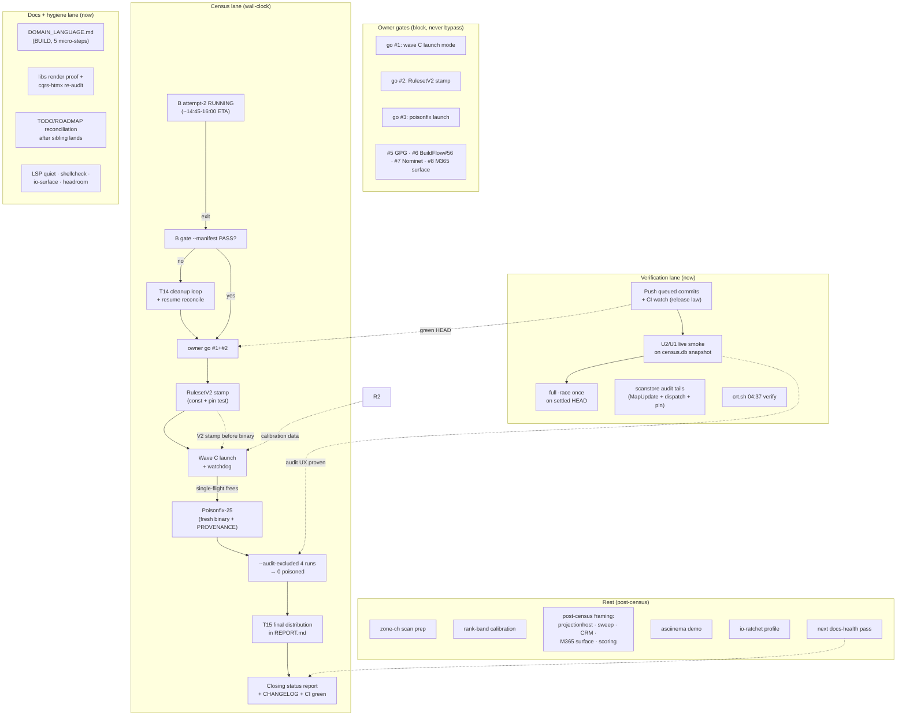

# SUPERB Pareto Plan — Closeout Round 2: census closure, verification wall, doc completion

**Written:** 2026-11-14 02:50 CET · **Mandate:** owner directive (pareto
breakdown, two-granularity plan, execution graph, commit, push).
**Supersedes execution order of** docs/planning/2026-11-14_00-42_* (its
U1/U2/U5/Q1/Q5 rows are landed — see errata). **Input universe:**
TODO_LIST.md open rows (02:50 read), the 02-46 docs-health report §f,
the 02-05 closeout §f, the 02-18 owner-decision package.

## Ground rules (Verschlimmbesser guardrails — unchanged and absolute)

1. **Single-flight law**: exactly ONE `gdd scan` (`pgrep -f
   'gdd[^ ]* scan'` before every launch). Wave B attempt-2 is running
   now; nothing launches until it exits.
2. **Never edit a script a running instance executes** — build in /tmp,
   `install` as a NEW inode; census-wave.sh/gate/watchdog frozen until
   B exits.
3. **Ruleset provenance is append-only**: the RulesetV2 stamp (owner
   ask #2) is a NEW value + pin-test update — never a V1 rewrite.
4. **Deliberate non-fixes stay non-fixed** (E003/B005/A032 journal
   surfaces, `-o`, vendorHash extraction, FormatsForShape, NXDOMAIN
   pre-filter, DENIC zone access, the 2026-11-12 www-strip policy).
   This plan does not relitigate them.
5. **Owner gates are real gates**: wave-C launch mode, RulesetV2,
   poisonfix go, Nominet send, GPG, BuildFlow#56 rebuild — packaged in
   docs/planning/2026-11-14_02-18-owner-decision-package.md, executed
   only on explicit answers.
6. **Lane fences**: the sibling session holds dirty files (STACK.md,
   TODO_LIST.md, scanstore.go, test splits) — those files are theirs
   until they commit; this plan's executor verifies, never tramples.

## Errata (what changed since the 00-42 plan — stale rows there)

- 00-42 U1 (`runs --format`), U2 (wave names), U5 (M365 fingerprints
  classify half), Q1 (file-size split), Q5 (TODO hygiene), Q6
  (CHANGELOG coherence + describe eyeball): **LANDED** — 02-05 report.
- Q3 (audit upkeep) shrank: the sibling swept the go-cqrs-lite.md
  verdict row (93b9a40); the cqrs-htmx re-audit + libs index render
  proof remain.
- R5 (owner-decision package): **WRITTEN** (02-18) — the remaining work
  is owner answers, not doc writing.
- The www-strip "policy" ask is answered by the 2026-11-12 census.md
  decision; only the rescan-in-C nuance (package ask #4) is live.
- STACK.md go-codec row: **LANDED** (1dbf7ce) — 01-45 §f20 / 02-05 §f16
  closed.

## Pareto analysis — what IS the result?

The product is **trustworthy census verdicts feeding the Kith CRM sales
signal**, delivered by a tool whose docs tell the truth. Wave B
completes ~14:45-16:00 today; wall-clock gates dominate, so the plan
runs a census lane (supervision + owner-gated launches), a verification
lane (prove the landed work is trustworthy), and a completion lane
(docs + hygiene tails).

### The 1% → 51%: the census chain closes

B completes → B gate PASS → RulesetV2 stamped → wave C launches →
poisonfix-25 runs → `--audit-excluded` reports **0 poisoned**. Every
downstream deliverable (T15, CRM deltas, coverage numbers) derives from
this chain. Active effort < 4 h; the rest is wall-clock. Nothing else
in the repo comes close.

### The 4% → 64%: the signal becomes usable and provably clean

+13%: T15's final whole-census distribution (the deliverable doc), the
U2/U1 live smoke on a census.db snapshot (the audit ritual proven on
the REAL journal), the rank-band calibration (B's ~2.8% band must not
cry wolf after C), and the push + CI-green-on-HEAD (the release law's
precondition — tonight's lint fix is committed but CI-blind).

### The 20% → 80%: the work is verifiable, the docs complete

+16%: the post-B verification bundle (full `-race` once, snapshot
restore-verify, disk headroom), the crt.sh 04:37 timer verification,
scanstore audit tails (MapUpdate source read, fold-dispatch read,
Recorder order pin), DOMAIN_LANGUAGE.md (the doc set's one missing
must-have), the audit-upkeep remainders (libs render proof, cqrs-htmx
re-audit), and the hygiene tails (LSP noise, shellcheck, io-surface,
file-size headroom).

### The rest → 100%

asciinema demo, zone-ch scan, post-census framing rows (projectionhost
API, go-cqrs-lite sweep, CRM confirm, enrichment/dedup, M365 surface,
lead scoring/delta timer), and the closing docs-health pass.

---

## Table 1 — Comprehensive plan (30–100 min tasks, ALL todos, sorted by importance/impact/effort/customer-value)

Lanes: **C** = census (wall-clock gated), **V** = verification (now),
**D** = docs (now), **H** = hygiene (now), **R** = rest (post-census /
owner). "Go" = owner gate (package ask #).

| #  | Task                                                                                                                                                                                                                                                    | Lane | Est  | Impact | Effort | Value | Depends on               |
| -- | ------------------------------------------------------------------------------------------------------------------------------------------------------------------------------------------------------------------------------------------------------- | ---- | ---- | ------ | ------ | ----- | ------------------------ |
| C1 | Monitor wave B to completion; watchdog/heartbeat watch; pgrep single-flight habit                                                                                                                                                                       | C    | 60m† | 10     | 2      | 10    | wall clock               |
| C2 | On B exit: summary → run-id; verify auto-gate PASS (`--manifest --expect-skip 96215`); T14 loop if FAIL                                                                                                                                                 | C    | 45m  | 10     | 3      | 10    | C1                       |
| C3 | RulesetV2 stamp: `ruleset.go` const + pin-test update + full classify tests (go #2)                                                                                                                                                                     | C    | 30m  | 10     | 2      | 10    | C2 pass, Go#2            |
| C4 | Launch wave C (V2-stamped binary, w4/10s, 5354, TCP preflight) + fresh watchdog (go #1)                                                                                                                                                                 | C    | 45m  | 9      | 3      | 9     | C3, Go#1                 |
| C5 | Poisonfix-25: fresh binary, PROVENANCE stamp + sha256, launch (go #3)                                                                                                                                                                                   | C    | 45m  | 10     | 3      | 10    | C4, Go#3                 |
| C6 | Closure proof: `--audit-excluded <4 runs>` → 0; snapshot restore-verify; census.db disk headroom                                                                                                                                                        | C    | 30m  | 10     | 2      | 10    | C5                       |
| C7 | T15 final whole-census distribution in reports/census/REPORT.md (journal-derived, replay cmd pinned, cross-check vs gate tallies)                                                                                                                       | C    | 60m  | 9      | 4      | 9     | C6                       |
| C8 | Closing status report + index row + CHANGELOG census line (go-release-ready state)                                                                                                                                                                      | C    | 30m  | 8      | 2      | 8     | C7                       |
| V1 | Push all queued commits; watch CI green on the exact pushed HEAD (release law)                                                                                                                                                                          | V    | 30m  | 9      | 1      | 9     | —                        |
| V2 | U2/U1 live smoke on a census.db SNAPSHOT: `--audit-excluded wave:` vs ledger counts, `runs --format jsonl` full IDs, ULID-vs-wave-name edge pin                                                                                                         | V    | 45m  | 8      | 3      | 8     | V1 (read-only on a copy) |
| V3 | Post-B verification bundle: full `-race ./...` once on settled HEAD (single lane)                                                                                                                                                                       | V    | 45m  | 7      | 2      | 7     | V1                       |
| V4 | scanstore audit tails: `MapUpdate` source read; memory/sqlite fold-dispatch snapshot read; Recorder sequential-dispatch pin test (17-43 §f5/§f12/§f19)                                                                                                  | V    | 60m  | 6      | 3      | 5     | —                        |
| V5 | crt.sh timer verification (04:37 + jitter landing, plausibility floor ≥100k .de rows)                                                                                                                                                                   | V    | 15m  | 6      | 1      | 6     | wall clock               |
| V6 | File-size headroom: coordinate the sibling's in-flight split to completion; re-verify `file-size-check` gate = 0                                                                                                                                        | H    | 45m  | 5      | 2      | 5     | sibling lands            |
| D1 | BUILD docs/DOMAIN_LANGUAGE.md (verdicts, evidence-only payloads, supersession, waves, rulesets, oracle semantics — from classify/scanstore usage)                                                                                                       | D    | 90m  | 7      | 4      | 6     | —                        |
| D2 | Audit upkeep: docs/review/libs index render proof re-shoot                                                                                                                                                                                              | D    | 30m  | 4      | 2      | 3     | —                        |
| D3 | Audit upkeep: cqrs-htmx verdict re-audit finish (go-cqrs-lite half swept by the sibling — verify it)                                                                                                                                                    | D    | 30m  | 5      | 2      | 4     | —                        |
| D4 | TODO_LIST/ROADMAP reconciliation sweep after the sibling's edits land (no TODO/ROADMAP dup re-introduced; docs-gates green)                                                                                                                             | D    | 30m  | 5      | 2      | 4     | sibling lands            |
| H1 | Hygiene: quiet LSP noise (gopls `infertypeargs` ×5 fix-or-suppress, golangci integration)                                                                                                                                                               | H    | 30m  | 3      | 2      | 2     | —                        |
| H2 | Hygiene: shellcheck findings in census scripts (SC2034 + quoting) — tidy or suppress with rationale                                                                                                                                                     | H    | 30m  | 3      | 2      | 2     | —                        |
| H3 | io-surface ranges.go:265 (stat-then-read TOCTOU): fix or record accept-with-rationale                                                                                                                                                                   | H    | 15m  | 2      | 1      | 1     | —                        |
| R1 | zone-ch scan: manifest + gate params + post-C slot (scan itself when single-flight frees)                                                                                                                                                               | R    | 60m  | 6      | 3      | 6     | C4 done                  |
| R2 | Poller rank-band unknown-rate expectations from B pass-1 data (+ "none"-share bound)                                                                                                                                                                    | R    | 45m  | 6      | 3      | 6     | C1 data                  |
| R3 | Post-census framing batch: projectionhost settled-API (repo: go-cqrs-lite), go-cqrs-lite patch sweep, CRM delta confirm (repo: crm), enrichment/registrant-dedup ROADMAP polish, M365 surface + DKIM probe (owner #8), lead scoring/delta-timer framing | R    | 60m  | 5      | 3      | 4     | C6                       |
| R4 | asciinema demo script + GIF + README embed                                                                                                                                                                                                              | R    | 90m  | 4      | 5      | 4     | —                        |
| R5 | io-history-ratchet `--profile-io` investigation (56 vs median 10)                                                                                                                                                                                       | R    | 60m  | 3      | 4      | 2     | —                        |
| R6 | Next docs-health pass after census closes (archive the 02-05/02-18/02-46 generation; TODO hygiene re-run)                                                                                                                                               | R    | 60m  | 5      | 2      | 4     | C8                       |

† C1 is spread-out supervision, not a 60-minute block.

**Owner-gated (never bypassed):** C3/C4/C5 launches (package asks #1-#3),
Nominet send (#7), GPG (#5), BuildFlow#56 rebuild (#6), M365 surface
(#8). Owner rows need NO repo work beyond the answers.

## Table 2 — Fine breakdown (≤12 min tasks, ALL todos; C/V/D/H/R lanes as above)

| ID   | Parent | Task (≤12 min)                                                                                           | Min | Verify                       |
| ---- | ------ | -------------------------------------------------------------------------------------------------------- | --- | ---------------------------- |
| C1.1 | C1     | Check monitor.log + watchdog.log tail for WATCHDOG/HEARTBEAT alarms                                      | 3   | no alarm lines               |
| C1.2 | C1     | Poll B progress: `wc -l run1.jsonl` vs ~400k; rate note in monitor.log                                   | 5   | rate ≥ ~3/s                  |
| C1.3 | C1     | Confirm exactly ONE scan process (pgrep dated-binary pattern)                                            | 2   | 1 line                       |
| C1.4 | C1     | Snapshot spot-check: newest reports/census/snapshots/ tar is fresh                                       | 5   | tar < 1 h old                |
| C2.1 | C2     | On B exit: read wrapper stderr summary + run id → run-id file                                            | 5   | summary present              |
| C2.2 | C2     | Re-run gate with `--manifest` + expected skips                                                           | 10  | exit 0                       |
| C2.3 | C2     | If gate FAIL: triage unknowns (T14 loop decision per docs/census.md)                                     | 12  | verdict recorded             |
| C3.1 | C3     | `ruleset.go`: add `RulesetV2 = "v2-2026-11-14"` per the 02-18 note; flip `CurrentRuleset`                | 8   | builds                       |
| C3.2 | C3     | Update `TestCurrentRulesetPinned`; run classify + scanstore tests (provenance stamps)                    | 10  | green                        |
| C3.3 | C3     | CHANGELOG line (RulesetV2 stamped; B/C comparison warning is correct behavior)                           | 5   | docs diff                    |
| C4.1 | C4     | Pre-launch: pgrep single-flight + preflight (REAL-UPSTREAM, `GDD_PREFLIGHT_TRANSPORT=tcp`)               | 5   | preflight pass               |
| C4.2 | C4     | Launch C via census-wave.sh (manifest tranco1m-c.txt, V2 binary)                                         | 8   | wrapper pid + log line       |
| C4.3 | C4     | Attach watchdog to C; first heartbeat seen                                                               | 5   | monitor.log line             |
| C5.1 | C5     | Build fresh binary; sha256 + VCS stamp into reports/census/unbound/PROVENANCE.md                         | 10  | stamp recorded               |
| C5.2 | C5     | Verify tranco1m-a-poisonfix.txt = 25 lines (sha256 vs ledger)                                            | 5   | hash match                   |
| C5.3 | C5     | Launch poisonfix wave (w4/10s/5354/tcp); attach watchdog                                                 | 10  | wrapper log                  |
| C6.1 | C6     | Run `replay --audit-excluded pilot,soak3,c4,c5` on live db                                               | 10  | findings count on stderr     |
| C6.2 | C6     | Assert 0 poisoned; append result to docs/census.md ledger                                                | 5   | ledger row                   |
| C6.3 | C6     | Restore-verify newest snapshot tar (sqlite integrity_check + counts)                                     | 10  | counts match                 |
| C6.4 | C6     | census.db disk headroom check for C + zone-ch                                                            | 5   | headroom noted               |
| C7.1 | C7     | Replay full census; extract verdict distribution by TLD + overall                                        | 12  | numbers pinned               |
| C7.2 | C7     | Write the distribution section + pin the exact replay command                                            | 12  | section in file              |
| C7.3 | C7     | Cross-check totals vs run tallies (gate numbers)                                                         | 8   | sums match                   |
| C8.1 | C8     | Closing status report (a-g) + docs/status index row                                                      | 12  | file + row                   |
| C8.2 | C8     | CHANGELOG census line; push; watch CI green                                                              | 12  | CI green                     |
| V1.1 | V1     | Stage + commit remaining session docs (status report, index, this plan)                                  | 5   | clean tree                   |
| V1.2 | V1     | `git push` origin + github (both remotes)                                                                | 5   | pushed                       |
| V1.3 | V1     | `gh run list` → watch the push-triggered CI run to green; investigate if red                             | 12  | green on HEAD                |
| V2.1 | V2     | Snapshot census.db read-only copy (`sqlite3 .backup`); never touch the live db                           | 5   | copy exists                  |
| V2.2 | V2     | `replay --audit-excluded wave:tranco1m-a --format jsonl` on the copy; diff vs ledger per-run counts      | 12  | counts match                 |
| V2.3 | V2     | `runs --format jsonl` on the copy: 26-char IDs + raw fields verified                                     | 8   | IDs untruncated              |
| V2.4 | V2     | Pin the ULID-vs-lowercase-wave-name edge with a test (impossible collision — assert it)                  | 12  | test green                   |
| V3.1 | V3     | `go test -race ./...` on the settled pushed HEAD (no other verification lane running)                    | 45→ | green                        |
| V4.1 | V4     | Read `sqliteengine/v4` `MapUpdate` source; confirm nil-prev upsert directly                              | 12  | finding noted                |
| V4.2 | V4     | Read `runtime_backend.go` fold dispatch; confirm shared task snapshot (memory vs sqlite)                 | 10  | finding noted                |
| V4.3 | V4     | Write the Recorder sequential-dispatch pin test                                                          | 12  | test green                   |
| V4.4 | V4     | Record findings in the scanstore audit-tails TODO row; close it                                          | 5   | row closed                   |
| V5.1 | V5     | Check reports/census/zone-data/ for the 04:37 timer artifact + plausibility floor                        | 5   | rows ≥ floor                 |
| V5.2 | V5     | Record the verification in monitor.log / census ledger                                                   | 5   | log line                     |
| V6.1 | V6     | Check the sibling's split state (`git status` test files); wait for their commit                         | 5   | no collision                 |
| V6.2 | V6     | After landing: `wc -l` the former 9 offenders; confirm all < 350                                         | 5   | all under cap                |
| V6.3 | V6     | `buildflow -s file-size-check` = 0 findings; strike the headroom TODO row                                | 10  | gate green                   |
| D1.1 | D1     | Harvest domain terms from classify (verdict, evidence, certainty, platform, ruleset)                     | 12  | term list                    |
| D1.2 | D1     | Harvest from scanstore (journal, stream, fold, projection, supersession, run, wave)                      | 12  | term list                    |
| D1.3 | D1     | Harvest from scan/resolve (probe, oracle, existence, NODATA, short-circuit) + input/render               | 12  | term list                    |
| D1.4 | D1     | Write docs/DOMAIN_LANGUAGE.md (table format, cross-links to AGENTS/FEATURES)                             | 12  | file exists                  |
| D1.5 | D1     | Docs-gates + go-structure-linter pass over the new file; commit                                          | 12  | gates green                  |
| D2.1 | D2     | Re-render docs/review/libs/index.html; screenshot/verify render                                          | 12  | renders                      |
| D2.2 | D2     | Record the render proof (commit + note in the audit README)                                              | 5   | note in file                 |
| D3.1 | D3     | Read the sibling's go-cqrs-lite.md sweep (93b9a40); verify it matches current go.mod pins                | 10  | verdict valid                |
| D3.2 | D3     | Re-audit cqrs-htmx verdict vs current pin; update the row                                                | 12  | row updated                  |
| D4.1 | D4     | Diff the sibling's TODO_LIST/ROADMAP sweeps for TODO/ROADMAP duplication                                 | 10  | no dup                       |
| D4.2 | D4     | Run docs-gates full battery; strike this plan's landed rows                                              | 12  | 5/5 PASS                     |
| H1.1 | H1     | Fix gopls `infertypeargs` (cli.go ×2, scanstore.go ×3): drop explicit type args                          | 10  | tests green                  |
| H1.2 | H1     | Quiet the stale golangci LSP integration (config or restart); verify IDE silence                         | 10  | no stale noise               |
| H2.1 | H2     | Fix census-gate.sh SC2034 (unused `errors` var)                                                          | 5   | shellcheck clean             |
| H2.2 | H2     | Fix census-wave.sh quoting findings (SC2086-class); respect the frozen-script law (post-B only)          | 12  | shellcheck clean             |
| H2.3 | H2     | Re-run shellcheck on scripts/; record zero-or-rationale                                                  | 5   | clean                        |
| H3.1 | H3     | ranges.go:265: replace stat-then-read with open-and-handle (or record accept rationale in the row)       | 12  | gate info resolved/justified |
| R1.1 | R1     | Draft zone-ch manifest + gate params (2.66M apexes, batched, w4/10s)                                     | 12  | draft ready                  |
| R1.2 | R1     | Slot note in census.md (post-C, disk/time estimate)                                                      | 8   | note in file                 |
| R2.1 | R2     | Extract B pass-1 unknown-rate by rank band (jsonl → bands)                                               | 12  | band table                   |
| R2.2 | R2     | Set GDD_WARN_PCT / per-band expectations; bound the "none" share                                         | 10  | config diff                  |
| R2.3 | R2     | Branch-test the poller warn path on a synthetic rate                                                     | 8   | warn fires                   |
| R3.1 | R3     | CRM delta confirm note (repo: crm; replay --since covers the diff logic)                                 | 12  | confirm note                 |
| R3.2 | R3     | projectionhost settled-API issue draft upstream (repo: go-cqrs-lite; reference = WaitProjectionsSettled) | 12  | draft ready                  |
| R3.3 | R3     | go-cqrs-lite patch sweep (system v4.18/metaengine v4.23 baseline; foldByEvent re-check on any bump)      | 12  | verdict                      |
| R3.4 | R3     | Enrichment/registrant-dedup/M365-surface/lead-scoring ROADMAP polish                                     | 10  | ROADMAP diff                 |
| R4.1 | R4     | Script the 60-domain demo scan (TTY, scripted output) → asciinema file                                   | 12  | recording                    |
| R4.2 | R4     | Edit + GIF conversion + README embed                                                                     | 12  | README shows                 |
| R5.1 | R5     | Run buildflow io-history profile; identify the 56-file offender                                          | 12  | offender named               |
| R5.2 | R5     | Memo-layer verdict: bug vs expected; NOTES.md or fix                                                     | 12  | verdict written              |
| R6.1 | R6     | docs-health AUDIT re-run post-census (harvest the closing report; archive the 02-05/02-18 generation)    | 12  | gates green                  |
| R6.2 | R6     | TODO_LIST hygiene re-run (strike this plan's landed rows via docs-gates)                                 | 12  | cadence green                |

## Execution graph

## What we are NOT doing (and why)

- **Launching C/poisonfix without owner go** — the 02-18 package owns
  the asks; this plan prepares and supervises, the owner decides.
- **Touching the sibling's dirty files** (STACK.md, TODO_LIST.md,
  scanstore.go, test splits) — lane fence; D4/V6 verify AFTER they land.
- **Relitigating decided/non-fixed items** — www-strip policy (2026-11-12),
  FormatsForShape, `-o`, E003/B005/A032, vendorHash extraction, DENIC;
  each has a recorded rationale (Verschlimmbesser by definition).
- **Journal compaction, lead scoring build, CAA probes** — ROADMAP-
  parked; no owner, not commitments.
- **Re-running the 00-42 plan's landed rows** (U1/U2/U5/Q1/Q5/Q6) —
  done; see Errata.
