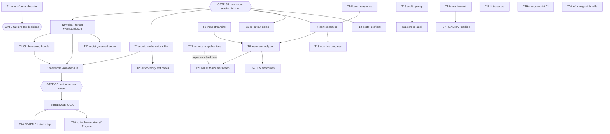

# Pareto Plan — Ship v0.1.0, then Scale Readiness

> **Archived 2026-11-14 (docs-health pass):** every task in this plan landed or was decided-against/superseded — per-row verdicts inline. Living context: TODO_LIST.md, ROADMAP.md, FEATURES.md, CHANGELOG.md.

**Written:** 2026-11-10 00:50 CET · **Repo state:** master @ b27032c
· **Inputs:** `TODO_LIST.md` (13 open items), the 2026-11-09 library audit
(`docs/review/libs/`, 22 reports), status report
`docs/status/2026-11-10_00-36_library-audit-session-review.md` (42 candidates)
· **Freshness check executed:** `--format` enum still 5 values, no `validate:`
tags, go-atomic-write still `// indirect` (go.mod:64), no resume/streaming in
`internal/cli` — every planned task verified still open. CHANGELOG `[Unreleased]`
reviewed; no overlap.

## Gates (read first — verschlimmbessern protection)

- **GATE G1 — concurrent session:** another session is actively building
  `internal/scanstore` + `internal/cli/replay.go` (cli_test.go modified at
  00:50). Every task touching `internal/cli`, `go.mod`, or `flake.nix`
  (vendorHash) waits until their tree is quiet. Do not refactor their code.
- **GATE G2 — release ordering:** the `--format` → `-o` rename decision (T1)
  must happen **before** the v0.1.0 tag (T6). Breaking changes after a tag
  cost a v2; before it, they cost one commit.
- **GATE G3 — tag readiness:** v0.1.0 only after the real-world validation
  run (T5) is clean.

## Pareto breakdown

### The 1% that delivers 51% — THE SPINE: ship v0.1.0

The tool already detects correctly. The single biggest value jump available
is making it _shipped_: format-complete output (one string!), crash-safe
caching (lib already in the binary), scriptable exit codes, one validated
real-world run, a tag. Six tasks, under a day, more than half the
currently-realizable value.

**T1** `-o` decision · **T2** widen `--format` · **T3** atomic cache write +
UA · **T4** CLI hardening bundle · **T5** real-world validation run ·
**T6** release v0.1.0.

### The 4% that delivers 64% — SCALE READINESS

The product exists for bulk technographics; bulk is currently fragile
(all-at-end rendering, full-RAM input, no resume, transient-resolver noise).
**T7** jsonl streaming · **T8** input streaming · **T9** resume ·
**T10** one-shot batch retry.

### The 20% that delivers 80% — POLISH & OPERATIONS

Everything that makes daily use and maintenance pleasant: output polish,
doctor preflight, live progress, install story, docs harvest, audit upkeep,
zone-data paperwork (long lead time — start early), lint cleanup, CI lint.

### The other 20% (to 100%) — LONG TAIL

Pre-filter sweep, CSV enrichment, scoped exit codes, drift-proof enum
generation, cqrs re-audit (post-scanstore), infrastructure niceties
(vendorHash.nix, freshness guard, describe contract test), ROADMAP parking.

## Execution graph

## Level 1 — comprehensive plan (tasks of 30–100 min, ALL TODOs, sorted by importance/impact/effort/customer-value)

| #                                                                                                                                                           | Task                                                                                                                                    | Tier     | Impact         | Cust.value     | Effort  | Gate            |
| ----------------------------------------------------------------------------------------------------------------------------------------------------------- | --------------------------------------------------------------------------------------------------------------------------------------- | -------- | -------------- | -------------- | ------- | --------------- |
| ~~T1~~ done — decided — `--format` kept, `-o` rejected (STACK.md decision log)                                                                              | ~~`-o/--output` vs `--format` decision + STACK.md record~~                                                                              | ~~1%~~   | ~~High~~       | ~~Medium~~     | ~~30m~~ | ~~—~~           |
| ~~T2~~ done at `4235e02`                                                                                                                                    | ~~Widen `--format` enum to +yaml,toml,jsonl (renderers already registered)~~                                                            | ~~1%~~   | ~~High~~       | ~~High~~       | ~~45m~~ | ~~G1~~          |
| ~~T3~~ done at `417afc7`                                                                                                                                    | ~~Adopt go-atomic-write `WriteWithPerm` in `writeCache` + UA header on feed~~                                                           | ~~1%~~   | ~~High~~       | ~~Medium~~     | ~~45m~~ | ~~G1~~          |
| ~~T4~~ done at `6fc85ab`                                                                                                                                    | ~~CLI hardening: `validate` on --workers, `ExitError(2)` usage errors, `WithEnvPrefix("GDD_")`, RecoveryMiddleware~~                    | ~~1%~~   | ~~High~~       | ~~High~~       | ~~60m~~ | ~~G1~~          |
| ~~T5~~ done — G3 PASS (07-46 report: journal round-trip byte-identical; NX-tail claim corrected by E1)                                                      | ~~Real-world validation run (lead list / Tranco slice), fix fallout~~                                                                   | ~~1%~~   | ~~High~~       | ~~High~~       | ~~90m~~ | ~~after T2-T4~~ |
| ~~T6~~ done — v0.1.0 tagged 9308d97, remotes + GitHub + proxy/pkg.go.dev/go-get verified (13-27/13-28)                                                      | ~~**Release v0.1.0** (CHANGELOG cut, tag, both remotes, GitHub release, proxy check)~~                                                  | ~~1%~~   | ~~Very high~~  | ~~Very high~~  | ~~90m~~ | ~~G2+G3~~       |
| ~~T7~~ done — jsonl streaming, completion order (50k smoke ~40 MiB flat)                                                                                    | ~~jsonl streaming output (render as completed; scan visitor refactor)~~                                                                 | ~~4%~~   | ~~High~~       | ~~High~~       | ~~90m~~ | ~~G1~~          |
| ~~T8~~ done — chunked streaming input (4096/chunk) + streaming replay journal walk                                                                          | ~~Input streaming in chunks (30M-domain memory fix)~~                                                                                   | ~~4%~~   | ~~High~~       | ~~High~~       | ~~90m~~ | ~~—~~           |
| ~~T9~~ done at `3674285`                                                                                                                                    | ~~Resume/checkpointing (`--resume results.jsonl`)~~                                                                                     | ~~4%~~   | ~~High~~       | ~~High~~       | ~~90m~~ | ~~T7,T8~~       |
| ~~T10~~ done at `49b87fc`                                                                                                                                   | ~~One-shot batch retry for transient resolver failures (hand-rolled, NOT go-retry)~~                                                    | ~~4%~~   | ~~Medium~~     | ~~High~~       | ~~45m~~ | ~~—~~           |
| ~~T11~~ done — go-output polish (colors, SetFooter, Title, AddRowChecked; E19)                                                                              | ~~go-output polish: `--color`, SetFooter summary, Title, AddRowChecked~~                                                                | ~~20%~~  | ~~Medium~~     | ~~Medium~~     | ~~60m~~ | ~~G1~~          |
| ~~T12~~ done — doctor dns-resolver + ranges-feed checks (internal/cli/doctor.go)                                                                            | ~~`WithDoctorCheck` preflight (resolver + ranges feed)~~                                                                                | ~~20%~~  | ~~Medium~~     | ~~Medium~~     | ~~45m~~ | ~~G1~~          |
| ~~T13~~ done — nom InlineRenderer TTY-only live progress                                                                                                    | ~~nom live progress for long scans (TTY-only)~~                                                                                         | ~~20%~~  | ~~Medium~~     | ~~Medium~~     | ~~60m~~ | ~~T7~~          |
| ~~T14~~ done — README overhaul + Install section + tap dbaa78c                                                                                              | ~~README install section + Homebrew tap entry~~                                                                                         | ~~20%~~  | ~~Medium~~     | ~~High~~       | ~~45m~~ | ~~T6~~          |
| ~~T15~~ done — TODO/FEATURES/CHANGELOG/STACK harvest (2026-11-10; re-harvested in the 2026-11-14 pass)                                                      | ~~Docs harvest: TODO_LIST/FEATURES/CHANGELOG/STACK from audit+plan~~                                                                    | ~~20%~~  | ~~Medium~~     | ~~Medium~~     | ~~45m~~ | ~~—~~           |
| ~~T16~~ done — citations re-verified via docs-gates; pins 47d74ba + audit-freshness.sh                                                                      | ~~Audit upkeep: citation re-verify vs HEAD, screenshot, commit-context, subagent check~~                                                | ~~20%~~  | ~~Medium~~     | ~~Low~~        | ~~45m~~ | ~~—~~           |
| ~~T17~~ done — DENIC resolved-impossible, Nominet draft ready, SWITCH verified (docs/zone-data/)                                                            | ~~Zone-data applications: DENIC RDS, Nominet DAA, SWITCH~~                                                                              | ~~20%~~  | ~~High(long)~~ | ~~High(long)~~ | ~~60m~~ | ~~—~~           |
| ~~T18~~ done — golangci-lint run = 0 issues (2026-11-13)                                                                                                    | ~~Lint cleanup pass (err113 ×N, cyclop ×2, wrapcheck, errcheck, tagalign)~~                                                             | ~~20%~~  | ~~Medium~~     | ~~Low~~        | ~~90m~~ | ~~G1~~          |
| ~~T19~~ done — cmdguard-lint CI job (pinned clone)                                                                                                          | ~~cmdguard-lint step in CI (expect 0 findings)~~                                                                                        | ~~20%~~  | ~~Low~~        | ~~Low~~        | ~~30m~~ | ~~—~~           |
| ~~T20~~ **Won't implement — decided-against with T1 (`-o` rejected).**                                                                                      | ~~`-o` implementation + JSON error envelopes (only if T1 = adopt)~~                                                                     | ~~20%~~  | ~~Medium~~     | ~~Medium~~     | ~~60m~~ | ~~T1, post-T6~~ |
| ~~T21~~ done — 17-43 conformance audit + 19-50 cqrs-lint triage to zero                                                                                     | ~~Re-audit go-cqrs-lite/cqrs-htmx verdicts after scanstore lands~~                                                                      | ~~20%~~  | ~~Medium~~     | ~~Low~~        | ~~30m~~ | ~~G1~~          |
| ~~T22~~ **Superseded — render.SupportedFormats() + TestFormatEnumsMatchRegistry keep the format set an explicit product contract (01-38 §a5).**             | ~~Registry-derived `values:` enum (drift-proof, `FormatsForShape`)~~                                                                    | ~~tail~~ | ~~Medium~~     | ~~Low~~        | ~~45m~~ | ~~T2~~          |
| ~~T23~~ **Superseded — in-scan existence oracle (resolve.LookupExistence, 7b45a1b) replaces any pre-filter.**                                               | ~~NXDOMAIN/A-existence pre-sweep pre-filter~~                                                                                           | ~~tail~~ | ~~High(long)~~ | ~~High(long)~~ | ~~90m~~ | ~~T9, T17~~     |
| ~~T24~~ done — `enrich` subcommand (internal/cli/enrich.go)                                                                                                 | ~~CSV enrichment mode (append verdict columns to input CSV)~~                                                                           | ~~tail~~ | ~~Medium~~     | ~~Medium~~     | ~~60m~~ | ~~—~~           |
| ~~T25~~ done — ranges.Error kinds -> exit 75/65 (E30)                                                                                                       | ~~Scoped go-error-family exit codes in `internal/ranges` (75/65)~~                                                                      | ~~tail~~ | ~~Low~~        | ~~Medium~~     | ~~30m~~ | ~~T3~~          |
| ~~T26~~ done — max-runtime (E31), describe current, freshness guard; vendorHash.nix + docs-gates cache-key deliberately non-fix/moot; CAA parked in ROADMAP | ~~Infra long-tail: TimeoutMiddleware, describe test, vendorHash.nix, freshness guard, docs-gates cache key, ETag-if-polled, CAA watch~~ | ~~tail~~ | ~~Low~~        | ~~Low~~        | ~~90m~~ | ~~G1~~          |
| ~~T27~~ done — ROADMAP.md created (CAA watch, compaction, lead scoring)                                                                                     | ~~ROADMAP parking of deferred items~~                                                                                                   | ~~tail~~ | ~~Low~~        | ~~Low~~        | ~~30m~~ | ~~T15~~         |

**Sequencing note:** T17 (paperwork) should START immediately in parallel —
approval lead times are weeks; nothing else blocks on it.

## Level 2 — fine breakdown (max 12 min per task, ALL TODOs, sorted within each L1 task by importance; global order = L1 order)

| ID                                                                                                                                                                                             | Task                                                                                      | Imp        | Eff                              | Gate    |
| ---------------------------------------------------------------------------------------------------------------------------------------------------------------------------------------------- | ----------------------------------------------------------------------------------------- | ---------- | -------------------------------- | ------- |
| ~~1.1~~ done — landed with parent T1 — decided — `--format` kept, `-o` rejected (STACK.md decision log)                                                                                        | ~~Read cmdguard `WithOutputFormat` + JSON-envelope docs~~                                 | ~~M~~      | ~~5m~~                           | ~~—~~   |
| ~~1.2~~ done — landed with parent T1 — decided — `--format` kept, `-o` rejected (STACK.md decision log)                                                                                        | ~~Decision memo: keep `--format` vs adopt `-o` (breaking-cost table)~~                    | ~~H~~      | ~~12m~~                          | ~~—~~   |
| ~~1.3~~ done — landed with parent T1 — decided — `--format` kept, `-o` rejected (STACK.md decision log)                                                                                        | ~~Record decision in STACK.md decision log~~                                              | ~~M~~      | ~~5m~~                           | ~~—~~   |
| ~~1.4~~ done — landed with parent T1 — decided — `--format` kept, `-o` rejected (STACK.md decision log)                                                                                        | ~~Update audit `cmdguard.md` gap #7 with outcome~~                                        | ~~M~~      | ~~5m~~                           | ~~—~~   |
| ~~1.5~~ done — landed with parent T1 — decided — `--format` kept, `-o` rejected (STACK.md decision log)                                                                                        | ~~CHANGELOG Unreleased note if breaking~~                                                 | ~~M~~      | ~~5m~~                           | ~~—~~   |
| ~~2.1~~ done at `landed with parent T2 — 4235e02`                                                                                                                                              | ~~Edit flag `values:` to `table,json,csv,tsv,markdown,yaml,toml,jsonl`~~                  | ~~H~~      | ~~5m~~                           | ~~G1~~  |
| ~~2.2~~ done at `landed with parent T2 — 4235e02`                                                                                                                                              | ~~render_test: yaml + toml + jsonl render goldens~~                                       | ~~H~~      | ~~12m~~                          | ~~G1~~  |
| ~~2.3~~ done at `landed with parent T2 — 4235e02`                                                                                                                                              | ~~describe/doctor golden updates if pinned~~                                              | ~~M~~      | ~~8m~~                           | ~~G1~~  |
| ~~2.4~~ done at `landed with parent T2 — 4235e02`                                                                                                                                              | ~~cli_test: enum accepts new values, rejects bogus~~                                      | ~~H~~      | ~~8m~~                           | ~~G1~~  |
| ~~2.5~~ done at `landed with parent T2 — 4235e02`                                                                                                                                              | ~~buildflow green~~                                                                       | ~~H~~      | ~~8m~~                           | ~~G1~~  |
| ~~3.1~~ done at `landed with parent T3 — 417afc7`                                                                                                                                              | ~~`go get go-atomic-write@v0.6.2` + tidy (direct dep)~~                                   | ~~H~~      | ~~6m~~                           | ~~G1~~  |
| ~~3.2~~ done at `landed with parent T3 — 417afc7`                                                                                                                                              | ~~Replace `writeCache` body: `WriteWithPerm(path, data, 0o600)`, keep `MkdirAll(0o700)`~~ | ~~H~~      | ~~8m~~                           | ~~G1~~  |
| ~~3.3~~ done at `landed with parent T3 — 417afc7`                                                                                                                                              | ~~`User-Agent: google-domain-detector/<version>` on feed request~~                        | ~~M~~      | ~~6m~~                           | ~~G1~~  |
| ~~3.4~~ done at `landed with parent T3 — 417afc7`                                                                                                                                              | ~~ranges_test: cache perms + concurrent-run race; confirm NOT `WriteIfChanged`~~          | ~~H~~      | ~~12m~~                          | ~~G1~~  |
| ~~3.5~~ done at `landed with parent T3 — 417afc7`                                                                                                                                              | ~~buildflow + vendorHash refresh if nix build trips~~                                     | ~~H~~      | ~~12m~~                          | ~~G1~~  |
| ~~4.1~~ done at `landed with parent T4 — 6fc85ab`                                                                                                                                              | ~~`validate:"min=1,max=512"` on Workers~~                                                 | ~~H~~      | ~~5m~~                           | ~~G1~~  |
| ~~4.2~~ done at `landed with parent T4 — 6fc85ab`                                                                                                                                              | ~~cli_test: `--workers 0` rejected at parse~~                                             | ~~H~~      | ~~8m~~                           | ~~G1~~  |
| ~~4.3~~ done at `landed with parent T4 — 6fc85ab`                                                                                                                                              | ~~`NewExitError(2, …)` on both usage errors~~                                             | ~~H~~      | ~~8m~~                           | ~~G1~~  |
| ~~4.4~~ done at `landed with parent T4 — 6fc85ab`                                                                                                                                              | ~~cli_test: usage error exits 2, scan failure 1~~                                         | ~~H~~      | ~~8m~~                           | ~~G1~~  |
| ~~4.5~~ done at `landed with parent T4 — 6fc85ab`                                                                                                                                              | ~~`WithEnvPrefix("GDD_")` + shorten env tags~~                                            | ~~M~~      | ~~10m~~                          | ~~G1~~  |
| ~~4.6~~ done at `landed with parent T4 — 6fc85ab`                                                                                                                                              | ~~cli_test: env resolution via prefix~~                                                   | ~~M~~      | ~~8m~~                           | ~~G1~~  |
| ~~4.7~~ done at `landed with parent T4 — 6fc85ab`                                                                                                                                              | ~~RecoveryMiddleware wiring~~                                                             | ~~M~~      | ~~6m~~                           | ~~G1~~  |
| ~~4.8~~ done at `landed with parent T4 — 6fc85ab`                                                                                                                                              | ~~cli_test: panic → printed error + exit 1~~                                              | ~~M~~      | ~~8m~~                           | ~~G1~~  |
| ~~5.1~~ done — landed with parent T5 — done — G3 PASS (07-46 report: journal round-trip byte-identical; NX-tail claim corrected by E1)                                                         | ~~Prepare lead list or Tranco top-10k slice~~                                             | ~~H~~      | ~~10m~~                          | ~~—~~   |
| ~~5.2~~ done — landed with parent T5 — done — G3 PASS (07-46 report: journal round-trip byte-identical; NX-tail claim corrected by E1)                                                         | ~~Run scan (table + json), capture timing/memory~~                                        | ~~H~~      | ~~10m~~                          | ~~—~~   |
| ~~5.3~~ done — landed with parent T5 — done — G3 PASS (07-46 report: journal round-trip byte-identical; NX-tail claim corrected by E1)                                                         | ~~Review Error/Skipped rows, classify causes~~                                            | ~~H~~      | ~~12m~~                          | ~~—~~   |
| ~~5.4~~ done — landed with parent T5 — done — G3 PASS (07-46 report: journal round-trip byte-identical; NX-tail claim corrected by E1)                                                         | ~~Manually verify 10 verdicts against live DNS~~                                          | ~~H~~      | ~~12m~~                          | ~~—~~   |
| ~~5.5~~ done — landed with parent T5 — done — G3 PASS (07-46 report: journal round-trip byte-identical; NX-tail claim corrected by E1)                                                         | ~~Fix fallout round 1~~                                                                   | ~~H~~      | ~~12m~~                          | ~~—~~   |
| ~~5.6~~ done — landed with parent T5 — done — G3 PASS (07-46 report: journal round-trip byte-identical; NX-tail claim corrected by E1)                                                         | ~~Fix fallout round 2~~                                                                   | ~~H~~      | ~~12m~~                          | ~~—~~   |
| ~~5.7~~ done — landed with parent T5 — done — G3 PASS (07-46 report: journal round-trip byte-identical; NX-tail claim corrected by E1)                                                         | ~~Record results in CHANGELOG + tag-readiness verdict~~                                   | ~~M~~      | ~~8m~~                           | ~~—~~   |
| ~~6.1~~ done — landed with parent T6 — done — v0.1.0 tagged 9308d97, remotes + GitHub + proxy/pkg.go.dev/go-get verified (13-27/13-28)                                                         | ~~Cut CHANGELOG 0.1.0 section~~                                                           | ~~H~~      | ~~10m~~                          | ~~G3~~  |
| ~~6.2~~ done — landed with parent T6 — done — v0.1.0 tagged 9308d97, remotes + GitHub + proxy/pkg.go.dev/go-get verified (13-27/13-28)                                                         | ~~Full buildflow green on release commit~~                                                | ~~H~~      | ~~10m~~                          | ~~G3~~  |
| ~~6.3~~ done — landed with parent T6 — done — v0.1.0 tagged 9308d97, remotes + GitHub + proxy/pkg.go.dev/go-get verified (13-27/13-28)                                                         | ~~Annotated tag v0.1.0~~                                                                  | ~~H~~      | ~~5m~~                           | ~~G3~~  |
| ~~6.4~~ done — landed with parent T6 — done — v0.1.0 tagged 9308d97, remotes + GitHub + proxy/pkg.go.dev/go-get verified (13-27/13-28)                                                         | ~~Push master+tag to origin AND github mirror~~                                           | ~~H~~      | ~~8m~~                           | ~~G3~~  |
| ~~6.5~~ done — landed with parent T6 — done — v0.1.0 tagged 9308d97, remotes + GitHub + proxy/pkg.go.dev/go-get verified (13-27/13-28)                                                         | ~~GitHub Release notes~~                                                                  | ~~H~~      | ~~12m~~                          | ~~G3~~  |
| ~~6.6~~ done — landed with parent T6 — done — v0.1.0 tagged 9308d97, remotes + GitHub + proxy/pkg.go.dev/go-get verified (13-27/13-28)                                                         | ~~Module proxy + pkg.go.dev propagation check~~                                           | ~~M~~      | ~~10m~~                          | ~~G3~~  |
| ~~6.7~~ done — landed with parent T6 — done — v0.1.0 tagged 9308d97, remotes + GitHub + proxy/pkg.go.dev/go-get verified (13-27/13-28)                                                         | ~~`nix run .#release` wiring check~~                                                      | ~~M~~      | ~~10m~~                          | ~~G3~~  |
| ~~6.8~~ done — landed with parent T6 — done — v0.1.0 tagged 9308d97, remotes + GitHub + proxy/pkg.go.dev/go-get verified (13-27/13-28)                                                         | ~~`go get` pull-check in scratch dir~~                                                    | ~~M~~      | ~~10m~~                          | ~~G3~~  |
| ~~6.9~~ done — landed with parent T6 — done — v0.1.0 tagged 9308d97, remotes + GitHub + proxy/pkg.go.dev/go-get verified (13-27/13-28)                                                         | ~~Rollback readiness note (retract plan)~~                                                | ~~M~~      | ~~5m~~                           | ~~G3~~  |
| ~~7.1~~ done — landed with parent T7 — done — jsonl streaming, completion order (50k smoke ~40 MiB flat)                                                                                       | ~~Design: results channel vs visitor callback in scan.Run~~                               | ~~H~~      | ~~10m~~                          | ~~G1~~  |
| ~~7.2~~ done — landed with parent T7 — done — jsonl streaming, completion order (50k smoke ~40 MiB flat)                                                                                       | ~~scan.Run visitor refactor (order-preserving)~~                                          | ~~H~~      | ~~12m~~                          | ~~G1~~  |
| ~~7.3~~ done — landed with parent T7 — done — jsonl streaming, completion order (50k smoke ~40 MiB flat)                                                                                       | ~~Streaming JSONL writer (DTO encode per completed result)~~                              | ~~H~~      | ~~12m~~                          | ~~G1~~  |
| ~~7.4~~ done — landed with parent T7 — done — jsonl streaming, completion order (50k smoke ~40 MiB flat)                                                                                       | ~~Wire `--format jsonl` to streaming path~~                                               | ~~H~~      | ~~5m~~                           | ~~G1~~  |
| ~~7.5~~ done — landed with parent T7 — done — jsonl streaming, completion order (50k smoke ~40 MiB flat)                                                                                       | ~~Semantics doc comment (ordering, cancellation)~~                                        | ~~M~~      | ~~8m~~                           | ~~G1~~  |
| ~~7.6~~ done — landed with parent T7 — done — jsonl streaming, completion order (50k smoke ~40 MiB flat)                                                                                       | ~~Tests: out-of-order completion, cancellation mid-stream~~                               | ~~H~~      | ~~12m~~                          | ~~G1~~  |
| ~~7.7~~ done — landed with parent T7 — done — jsonl streaming, completion order (50k smoke ~40 MiB flat)                                                                                       | ~~50k-domain smoke run + memory check~~                                                   | ~~H~~      | ~~10m~~                          | ~~G1~~  |
| ~~7.8~~ done — landed with parent T7 — done — jsonl streaming, completion order (50k smoke ~40 MiB flat)                                                                                       | ~~buildflow green~~                                                                       | ~~H~~      | ~~8m~~                           | ~~G1~~  |
| ~~8.1~~ done — landed with parent T8 — done — chunked streaming input (4096/chunk) + streaming replay journal walk                                                                             | ~~Refactor input.Parse to streaming reader~~                                              | ~~H~~      | ~~12m~~                          | ~~—~~   |
| ~~8.2~~ done — landed with parent T8 — done — chunked streaming input (4096/chunk) + streaming replay journal walk                                                                             | ~~Chunked collectDomains~~                                                                | ~~H~~      | ~~12m~~                          | ~~—~~   |
| ~~8.3~~ done — landed with parent T8 — done — chunked streaming input (4096/chunk) + streaming replay journal walk                                                                             | ~~Cross-chunk dedup structure~~                                                           | ~~H~~      | ~~10m~~                          | ~~—~~   |
| ~~8.4~~ done — landed with parent T8 — done — chunked streaming input (4096/chunk) + streaming replay journal walk                                                                             | ~~Streaming-safe CSV header detection~~                                                   | ~~H~~      | ~~12m~~                          | ~~—~~   |
| ~~8.5~~ done — landed with parent T8 — done — chunked streaming input (4096/chunk) + streaming replay journal walk                                                                             | ~~Skipped aggregation across chunks~~                                                     | ~~M~~      | ~~8m~~                           | ~~—~~   |
| ~~8.6~~ done — landed with parent T8 — done — chunked streaming input (4096/chunk) + streaming replay journal walk                                                                             | ~~Memory before/after profile~~                                                           | ~~M~~      | ~~10m~~                          | ~~—~~   |
| ~~8.7~~ done — landed with parent T8 — done — chunked streaming input (4096/chunk) + streaming replay journal walk                                                                             | ~~Parity tests stdin/file/args~~                                                          | ~~H~~      | ~~12m~~                          | ~~—~~   |
| ~~8.8~~ done — landed with parent T8 — done — chunked streaming input (4096/chunk) + streaming replay journal walk                                                                             | ~~buildflow green~~                                                                       | ~~H~~      | ~~8m~~                           | ~~—~~   |
| ~~9.1~~ done at `landed with parent T9 — 3674285`                                                                                                                                              | ~~Decide checkpoint format (jsonl out-file doubles as checkpoint)~~                       | ~~H~~      | ~~8m~~                           | ~~T7~~  |
| ~~9.2~~ done at `landed with parent T9 — 3674285`                                                                                                                                              | ~~`--resume` flag plumbing + help text~~                                                  | ~~H~~      | ~~10m~~                          | ~~T7~~  |
| ~~9.3~~ done at `landed with parent T9 — 3674285`                                                                                                                                              | ~~Build skip-set from existing output file~~                                              | ~~H~~      | ~~10m~~                          | ~~T7~~  |
| ~~9.4~~ done at `landed with parent T9 — 3674285`                                                                                                                                              | ~~Append-mode output open~~                                                               | ~~H~~      | ~~8m~~                           | ~~T7~~  |
| ~~9.5~~ done at `landed with parent T9 — 3674285`                                                                                                                                              | ~~Integrate with streaming render~~                                                       | ~~H~~      | ~~12m~~                          | ~~T7~~  |
| ~~9.6~~ done at `landed with parent T9 — 3674285`                                                                                                                                              | ~~Test: rerun skips completed domains~~                                                   | ~~H~~      | ~~12m~~                          | ~~T7~~  |
| ~~9.7~~ done at `landed with parent T9 — 3674285`                                                                                                                                              | ~~Test: corrupt/truncated checkpoint handling~~                                           | ~~M~~      | ~~10m~~                          | ~~T7~~  |
| ~~10.1~~ done at `landed with parent T10 — 49b87fc`                                                                                                                                            | ~~Classify transient vs permanent DNSError~~                                              | ~~H~~      | ~~10m~~                          | ~~—~~   |
| ~~10.2~~ done at `landed with parent T10 — 49b87fc`                                                                                                                                            | ~~Single retry in ScanDomain on transient only~~                                          | ~~H~~      | ~~10m~~                          | ~~—~~   |
| ~~10.3~~ done at `landed with parent T10 — 49b87fc`                                                                                                                                            | ~~Test: hard NXDOMAIN not retried~~                                                       | ~~H~~      | ~~10m~~                          | ~~—~~   |
| ~~10.4~~ done at `landed with parent T10 — 49b87fc`                                                                                                                                            | ~~Test: flaky resolver recovers on retry~~                                                | ~~H~~      | ~~10m~~                          | ~~—~~   |
| ~~10.5~~ done at `landed with parent T10 — 49b87fc`                                                                                                                                            | ~~buildflow green~~                                                                       | ~~H~~      | ~~5m~~                           | ~~—~~   |
| ~~11.1~~ done — landed with parent T11 — done — go-output polish (colors, SetFooter, Title, AddRowChecked; E19)                                                                                | ~~`--color auto~~                                                                         | ~~always~~ | ~~never` flag + ParseColorMode~~ | ~~M~~   |
| ~~11.2~~ done — landed with parent T11 — done — go-output polish (colors, SetFooter, Title, AddRowChecked; E19)                                                                                | ~~Plumb ColorMode into RenderOptions~~                                                    | ~~M~~      | ~~6m~~                           | ~~G1~~  |
| ~~11.3~~ done — landed with parent T11 — done — go-output polish (colors, SetFooter, Title, AddRowChecked; E19)                                                                                | ~~SetFooter summary row ("N domains · M workspace · K gcp")~~                             | ~~M~~      | ~~12m~~                          | ~~G1~~  |
| ~~11.4~~ done — landed with parent T11 — done — go-output polish (colors, SetFooter, Title, AddRowChecked; E19)                                                                                | ~~Footer render tests csv/tsv/markdown~~                                                  | ~~M~~      | ~~10m~~                          | ~~G1~~  |
| ~~11.5~~ done — landed with parent T11 — done — go-output polish (colors, SetFooter, Title, AddRowChecked; E19)                                                                                | ~~Title option + markdown test~~                                                          | ~~L~~      | ~~8m~~                           | ~~G1~~  |
| ~~11.6~~ done — landed with parent T11 — done — go-output polish (colors, SetFooter, Title, AddRowChecked; E19)                                                                                | ~~AddRowChecked swap~~                                                                    | ~~M~~      | ~~6m~~                           | ~~G1~~  |
| ~~11.7~~ done — landed with parent T11 — done — go-output polish (colors, SetFooter, Title, AddRowChecked; E19)                                                                                | ~~buildflow green~~                                                                       | ~~M~~      | ~~8m~~                           | ~~G1~~  |
| ~~12.1~~ done — landed with parent T12 — done — doctor dns-resolver + ranges-feed checks (internal/cli/doctor.go)                                                                              | ~~WithDoctorCheck wiring scaffold~~                                                       | ~~M~~      | ~~8m~~                           | ~~G1~~  |
| ~~12.2~~ done — landed with parent T12 — done — doctor dns-resolver + ranges-feed checks (internal/cli/doctor.go)                                                                              | ~~Resolver reachability check (bounded lookup)~~                                          | ~~M~~      | ~~12m~~                          | ~~G1~~  |
| ~~12.3~~ done — landed with parent T12 — done — doctor dns-resolver + ranges-feed checks (internal/cli/doctor.go)                                                                              | ~~Ranges feed fetch+parse check~~                                                         | ~~M~~      | ~~12m~~                          | ~~G1~~  |
| ~~12.4~~ done — landed with parent T12 — done — doctor dns-resolver + ranges-feed checks (internal/cli/doctor.go)                                                                              | ~~doctor_test with fake resolver/feed~~                                                   | ~~M~~      | ~~10m~~                          | ~~G1~~  |
| ~~13.1~~ done — landed with parent T13 — done — nom InlineRenderer TTY-only live progress                                                                                                      | ~~Evaluate go-output/nom API surface~~                                                    | ~~M~~      | ~~8m~~                           | ~~T7~~  |
| ~~13.2~~ done — landed with parent T13 — done — nom InlineRenderer TTY-only live progress                                                                                                      | ~~Wire activity feed into worker loop~~                                                   | ~~M~~      | ~~12m~~                          | ~~T7~~  |
| ~~13.3~~ done — landed with parent T13 — done — nom InlineRenderer TTY-only live progress                                                                                                      | ~~TTY-only activation gate~~                                                              | ~~M~~      | ~~8m~~                           | ~~T7~~  |
| ~~13.4~~ done — landed with parent T13 — done — nom InlineRenderer TTY-only live progress                                                                                                      | ~~CI/pipe quiet-mode verification~~                                                       | ~~M~~      | ~~6m~~                           | ~~T7~~  |
| ~~13.5~~ done — landed with parent T13 — done — nom InlineRenderer TTY-only live progress                                                                                                      | ~~Visual check on 1k-domain run~~                                                         | ~~M~~      | ~~10m~~                          | ~~T7~~  |
| ~~14.1~~ done — landed with parent T14 — done — README overhaul + Install section + tap dbaa78c                                                                                                | ~~README install section (nix/brew/go install) + link check~~                             | ~~H~~      | ~~12m~~                          | ~~T6~~  |
| ~~14.2~~ done — landed with parent T14 — done — README overhaul + Install section + tap dbaa78c                                                                                                | ~~Quickstart + examples block~~                                                           | ~~M~~      | ~~8m~~                           | ~~T6~~  |
| ~~14.3~~ done — landed with parent T14 — done — README overhaul + Install section + tap dbaa78c                                                                                                | ~~Homebrew formula draft in homebrew-tap repo~~                                           | ~~H~~      | ~~12m~~                          | ~~T6~~  |
| ~~14.4~~ done — landed with parent T14 — done — README overhaul + Install section + tap dbaa78c                                                                                                | ~~Tap CI verification~~                                                                   | ~~M~~      | ~~8m~~                           | ~~T6~~  |
| ~~15.1~~ done — landed with parent T15 — done — TODO/FEATURES/CHANGELOG/STACK harvest (2026-11-10; re-harvested in the 2026-11-14 pass)                                                        | ~~Merge audit follow-ups into TODO_LIST (jsonl dedup note)~~                              | ~~M~~      | ~~10m~~                          | ~~—~~   |
| ~~15.2~~ done — landed with parent T15 — done — TODO/FEATURES/CHANGELOG/STACK harvest (2026-11-10; re-harvested in the 2026-11-14 pass)                                                        | ~~FEATURES.md status refresh~~                                                            | ~~M~~      | ~~12m~~                          | ~~—~~   |
| ~~15.3~~ done — landed with parent T15 — done — TODO/FEATURES/CHANGELOG/STACK harvest (2026-11-10; re-harvested in the 2026-11-14 pass)                                                        | ~~CHANGELOG entries for shipped ops work~~                                                | ~~M~~      | ~~8m~~                           | ~~—~~   |
| ~~15.4~~ done — landed with parent T15 — done — TODO/FEATURES/CHANGELOG/STACK harvest (2026-11-10; re-harvested in the 2026-11-14 pass)                                                        | ~~STACK.md rows for newly adopted deps~~                                                  | ~~M~~      | ~~8m~~                           | ~~—~~   |
| ~~15.5~~ done — landed with parent T15 — done — TODO/FEATURES/CHANGELOG/STACK harvest (2026-11-10; re-harvested in the 2026-11-14 pass)                                                        | ~~docs-gates green~~                                                                      | ~~M~~      | ~~7m~~                           | ~~—~~   |
| ~~16.1~~ done — landed with parent T16 — done — citations re-verified via docs-gates; pins 47d74ba + audit-freshness.sh                                                                        | ~~Status-check/stop subagents akiko+celeste; diff late reports~~                          | ~~L~~      | ~~10m~~                          | ~~—~~   |
| ~~16.2~~ done — landed with parent T16 — done — citations re-verified via docs-gates; pins 47d74ba + audit-freshness.sh                                                                        | ~~Re-verify all project citations vs current HEAD~~                                       | ~~M~~      | ~~12m~~                          | ~~—~~   |
| ~~16.3~~ done — landed with parent T16 — done — citations re-verified via docs-gates; pins 47d74ba + audit-freshness.sh                                                                        | ~~Re-screenshot index + href re-check~~                                                   | ~~L~~      | ~~8m~~                           | ~~—~~   |
| ~~16.4~~ done — landed with parent T16 — done — citations re-verified via docs-gates; pins 47d74ba + audit-freshness.sh                                                                        | ~~Add verified-at-commit headers to 22 reports~~                                          | ~~M~~      | ~~10m~~                          | ~~—~~   |
| ~~17.1~~ done — landed with parent T17 — done — DENIC resolved-impossible, Nominet draft ready, SWITCH verified (docs/zone-data/)                                                              | ~~DENIC RDS application draft + send~~                                                    | ~~H~~      | ~~12m~~                          | ~~—~~   |
| ~~17.2~~ done — landed with parent T17 — done — DENIC resolved-impossible, Nominet draft ready, SWITCH verified (docs/zone-data/)                                                              | ~~Nominet DAA application + send~~                                                        | ~~H~~      | ~~12m~~                          | ~~—~~   |
| ~~17.3~~ done — landed with parent T17 — done — DENIC resolved-impossible, Nominet draft ready, SWITCH verified (docs/zone-data/)                                                              | ~~SWITCH zone-data request + send~~                                                       | ~~H~~      | ~~12m~~                          | ~~—~~   |
| ~~17.4~~ done — landed with parent T17 — done — DENIC resolved-impossible, Nominet draft ready, SWITCH verified (docs/zone-data/)                                                              | ~~ccTLD data-usage constraint review~~                                                    | ~~M~~      | ~~12m~~                          | ~~—~~   |
| ~~17.5~~ done — landed with parent T17 — done — DENIC resolved-impossible, Nominet draft ready, SWITCH verified (docs/zone-data/)                                                              | ~~Track application follow-ups in TODO~~                                                  | ~~M~~      | ~~5m~~                           | ~~—~~   |
| ~~18.1~~ done — landed with parent T18 — done — golangci-lint run = 0 issues (2026-11-13)                                                                                                      | ~~err113: static sentinels in domain.go~~                                                 | ~~M~~      | ~~12m~~                          | ~~G1~~  |
| ~~18.2~~ done — landed with parent T18 — done — golangci-lint run = 0 issues (2026-11-13)                                                                                                      | ~~err113: input.go + ranges.go~~                                                          | ~~M~~      | ~~12m~~                          | ~~G1~~  |
| ~~18.3~~ done — landed with parent T18 — done — golangci-lint run = 0 issues (2026-11-13)                                                                                                      | ~~err113: cli.go + replay.go (coordinate with concurrent session)~~                       | ~~M~~      | ~~12m~~                          | ~~G1~~  |
| ~~18.4~~ done — landed with parent T18 — done — golangci-lint run = 0 issues (2026-11-13)                                                                                                      | ~~cyclop: extract helper from scan.Run~~                                                  | ~~M~~      | ~~12m~~                          | ~~G1~~  |
| ~~18.5~~ done — landed with parent T18 — done — golangci-lint run = 0 issues (2026-11-13)                                                                                                      | ~~cyclop: split ScanDomain stages~~                                                       | ~~M~~      | ~~12m~~                          | ~~G1~~  |
| ~~18.6~~ done — landed with parent T18 — done — golangci-lint run = 0 issues (2026-11-13)                                                                                                      | ~~wrapcheck + nilnil + mnd fixes~~                                                        | ~~M~~      | ~~12m~~                          | ~~G1~~  |
| ~~18.7~~ done — landed with parent T18 — done — golangci-lint run = 0 issues (2026-11-13)                                                                                                      | ~~errcheck Fprintf + varnamelen + tagalign~~                                              | ~~L~~      | ~~12m~~                          | ~~G1~~  |
| ~~18.8~~ done — landed with parent T18 — done — golangci-lint run = 0 issues (2026-11-13)                                                                                                      | ~~Full buildflow green incl. race~~                                                       | ~~H~~      | ~~12m~~                          | ~~G1~~  |
| ~~19.1~~ done — landed with parent T19 — done — cmdguard-lint CI job (pinned clone)                                                                                                            | ~~Add cmdguard-lint step to ci.yml~~                                                      | ~~L~~      | ~~10m~~                          | ~~—~~   |
| ~~19.2~~ done — landed with parent T19 — done — cmdguard-lint CI job (pinned clone)                                                                                                            | ~~Local run, expect 0 findings~~                                                          | ~~L~~      | ~~8m~~                           | ~~—~~   |
| ~~19.3~~ done — landed with parent T19 — done — cmdguard-lint CI job (pinned clone)                                                                                                            | ~~Fix or document any findings~~                                                          | ~~L~~      | ~~12m~~                          | ~~—~~   |
| ~~20.1~~ **Won't implement — landed with parent T20 — decided-against with T1 (`-o` rejected).**                                                                                               | ~~WithOutputFormat adoption + flag swap + describe golden~~                               | ~~M~~      | ~~12m~~                          | ~~T1~~  |
| ~~20.2~~ **Won't implement — landed with parent T20 — decided-against with T1 (`-o` rejected).**                                                                                               | ~~JSON error envelope tests (hint/code fields)~~                                          | ~~M~~      | ~~12m~~                          | ~~T1~~  |
| ~~20.3~~ **Won't implement — landed with parent T20 — decided-against with T1 (`-o` rejected).**                                                                                               | ~~README + audit doc updates~~                                                            | ~~M~~      | ~~8m~~                           | ~~T1~~  |
| ~~21.1~~ done — landed with parent T21 — done — 17-43 conformance audit + 19-50 cqrs-lint triage to zero                                                                                       | ~~Read final scanstore/replay shape~~                                                     | ~~M~~      | ~~10m~~                          | ~~G1~~  |
| ~~21.2~~ done — landed with parent T21 — done — 17-43 conformance audit + 19-50 cqrs-lint triage to zero                                                                                       | ~~Update go-cqrs-lite.md + cqrs-htmx.md verdicts~~                                        | ~~M~~      | ~~12m~~                          | ~~G1~~  |
| ~~21.3~~ done — landed with parent T21 — done — 17-43 conformance audit + 19-50 cqrs-lint triage to zero                                                                                       | ~~Refresh index.html matrix + re-render proof~~                                           | ~~M~~      | ~~8m~~                           | ~~G1~~  |
| ~~22.1~~ **Superseded — landed with parent T22 — render.SupportedFormats() + TestFormatEnumsMatchRegistry keep the format set an explicit product contract (01-38 §a5).**                      | ~~Investigate registry introspection API (FormatsForShape)~~                              | ~~M~~      | ~~8m~~                           | ~~T2~~  |
| ~~22.2~~ **Superseded — landed with parent T22 — render.SupportedFormats() + TestFormatEnumsMatchRegistry keep the format set an explicit product contract (01-38 §a5).**                      | ~~Generate flag values from registered formats, drop hardcoded enum~~                     | ~~M~~      | ~~12m~~                          | ~~T2~~  |
| ~~22.3~~ **Superseded — landed with parent T22 — render.SupportedFormats() + TestFormatEnumsMatchRegistry keep the format set an explicit product contract (01-38 §a5).**                      | ~~Drift-proof test: registry == enum~~                                                    | ~~M~~      | ~~10m~~                          | ~~T2~~  |
| ~~23.1~~ **Superseded — landed with parent T23 — in-scan existence oracle (resolve.LookupExistence, 7b45a1b) replaces any pre-filter.**                                                        | ~~Design: parallel A-record existence pass~~                                              | ~~M~~      | ~~12m~~                          | ~~T9~~  |
| ~~23.2~~ **Superseded — landed with parent T23 — in-scan existence oracle (resolve.LookupExistence, 7b45a1b) replaces any pre-filter.**                                                        | ~~Implement sweep phase~~                                                                 | ~~M~~      | ~~12m~~                          | ~~T9~~  |
| ~~23.3~~ **Superseded — landed with parent T23 — in-scan existence oracle (resolve.LookupExistence, 7b45a1b) replaces any pre-filter.**                                                        | ~~`--pre-filter` flag + help/docs~~                                                       | ~~M~~      | ~~10m~~                          | ~~T9~~  |
| ~~23.4~~ **Superseded — landed with parent T23 — in-scan existence oracle (resolve.LookupExistence, 7b45a1b) replaces any pre-filter.**                                                        | ~~Volume-reduction measurement on sample~~                                                | ~~M~~      | ~~10m~~                          | ~~T9~~  |
| ~~23.5~~ **Superseded — landed with parent T23 — in-scan existence oracle (resolve.LookupExistence, 7b45a1b) replaces any pre-filter.**                                                        | ~~Worker-pool bounds integration~~                                                        | ~~M~~      | ~~12m~~                          | ~~T9~~  |
| ~~23.6~~ **Superseded — landed with parent T23 — in-scan existence oracle (resolve.LookupExistence, 7b45a1b) replaces any pre-filter.**                                                        | ~~Tests~~                                                                                 | ~~H~~      | ~~12m~~                          | ~~T9~~  |
| ~~24.1~~ done — landed with parent T24 — done — `enrich` subcommand (internal/cli/enrich.go)                                                                                                   | ~~Column-append design incl. header mapping~~                                             | ~~M~~      | ~~10m~~                          | ~~—~~   |
| ~~24.2~~ done — landed with parent T24 — done — `enrich` subcommand (internal/cli/enrich.go)                                                                                                   | ~~Writer preserving original columns~~                                                    | ~~M~~      | ~~12m~~                          | ~~—~~   |
| ~~24.3~~ done — landed with parent T24 — done — `enrich` subcommand (internal/cli/enrich.go)                                                                                                   | ~~Quote/escape edge cases~~                                                               | ~~M~~      | ~~10m~~                          | ~~—~~   |
| ~~24.4~~ done — landed with parent T24 — done — `enrich` subcommand (internal/cli/enrich.go)                                                                                                   | ~~Tests incl. ragged CSV~~                                                                | ~~H~~      | ~~12m~~                          | ~~—~~   |
| ~~25.1~~ done — landed with parent T25 — done — ranges.Error kinds -> exit 75/65 (E30)                                                                                                         | ~~Wrap ranges fetch/parse with family constructors~~                                      | ~~L~~      | ~~10m~~                          | ~~T3~~  |
| ~~25.2~~ done — landed with parent T25 — done — ranges.Error kinds -> exit 75/65 (E30)                                                                                                         | ~~Exit-code test (75 fetch / 65 corrupt)~~                                                | ~~L~~      | ~~10m~~                          | ~~T3~~  |
| ~~25.3~~ done — landed with parent T25 — done — ranges.Error kinds -> exit 75/65 (E30)                                                                                                         | ~~AGENTS/audit note update~~                                                              | ~~L~~      | ~~5m~~                           | ~~T3~~  |
| ~~26.1~~ done — landed with parent T26 — done — --max-runtime (E31), describe current, freshness guard; vendorHash.nix + docs-gates cache-key deliberately non-fix/moot; CAA parked in ROADMAP | ~~TimeoutMiddleware optional whole-run budget~~                                           | ~~L~~      | ~~10m~~                          | ~~G1~~  |
| ~~26.2~~ done — landed with parent T26 — done — --max-runtime (E31), describe current, freshness guard; vendorHash.nix + docs-gates cache-key deliberately non-fix/moot; CAA parked in ROADMAP | ~~describe contract test~~                                                                | ~~L~~      | ~~10m~~                          | ~~G1~~  |
| ~~26.3~~ done — landed with parent T26 — done — --max-runtime (E31), describe current, freshness guard; vendorHash.nix + docs-gates cache-key deliberately non-fix/moot; CAA parked in ROADMAP | ~~vendorHash extraction to vendorHash.nix~~                                               | ~~L~~      | ~~12m~~                          | ~~G1~~  |
| ~~26.4~~ done — landed with parent T26 — done — --max-runtime (E31), describe current, freshness guard; vendorHash.nix + docs-gates cache-key deliberately non-fix/moot; CAA parked in ROADMAP | ~~Version-freshness guard for audit reports~~                                             | ~~L~~      | ~~12m~~                          | ~~—~~   |
| ~~26.5~~ done — landed with parent T26 — done — --max-runtime (E31), describe current, freshness guard; vendorHash.nix + docs-gates cache-key deliberately non-fix/moot; CAA parked in ROADMAP | ~~docs-gates cache-key disagreement investigation~~                                       | ~~L~~      | ~~12m~~                          | ~~—~~   |
| ~~26.6~~ done — landed with parent T26 — done — --max-runtime (E31), describe current, freshness guard; vendorHash.nix + docs-gates cache-key deliberately non-fix/moot; CAA parked in ROADMAP | ~~ETag revalidation on feed (only if polled >daily)~~                                     | ~~L~~      | ~~12m~~                          | ~~—~~   |
| ~~27.1~~ done — landed with parent T27 — done — ROADMAP.md created (CAA watch, compaction, lead scoring)                                                                                       | ~~Write deferred items + CAA watch into ROADMAP.md~~                                      | ~~M~~      | ~~12m~~                          | ~~T15~~ |
| ~~27.2~~ done — landed with parent T27 — done — ROADMAP.md created (CAA watch, compaction, lead scoring)                                                                                       | ~~docs-gates green~~                                                                      | ~~M~~      | ~~5m~~                           | ~~T15~~ |

**Counts:** 27 L1 tasks (spine 6 · scale 4 · polish 10 · tail 7) · 141 L2
tasks · total est. ≈ 26 h.

## Errata / corrections applied during Step 0

- TODO_LIST's `--jsonl` item merged with the audit's format-widening: T2
  ships non-streaming jsonl (flag enum), T7 ships streaming. Both needed;
  they are different features sharing a format name.
- Audit "widen enum" (status item 1) verified still unimplemented (enum is
  5 values at cli.go:40).
- Zone-data items kept despite low immediate customer value: their lead
  time (weeks) dominates; starting now is the 20%-tier action.
- Deliberately NOT planned: any refactor of the concurrent session's
  scanstore/replay code beyond the lint fixes explicitly flagged in T18.3
  (coordinate first). Verschlimmbessern guard.

## Post-plan note (docs-health)

New tasks surfaced here must be folded into `TODO_LIST.md` (done in the
same commit: new "Library audit follow-ups" section). The plan file is the
snapshot; TODO_LIST stays the living source.
